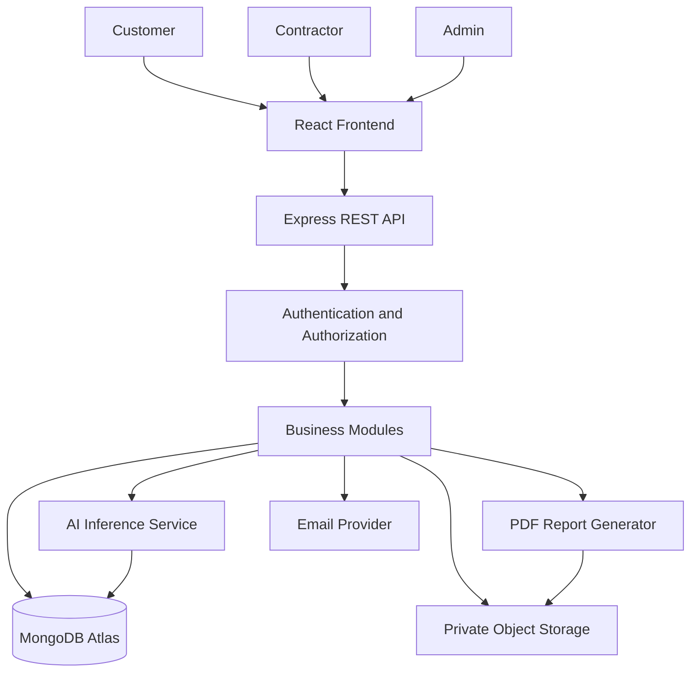
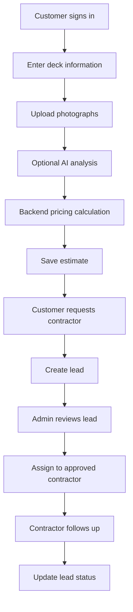
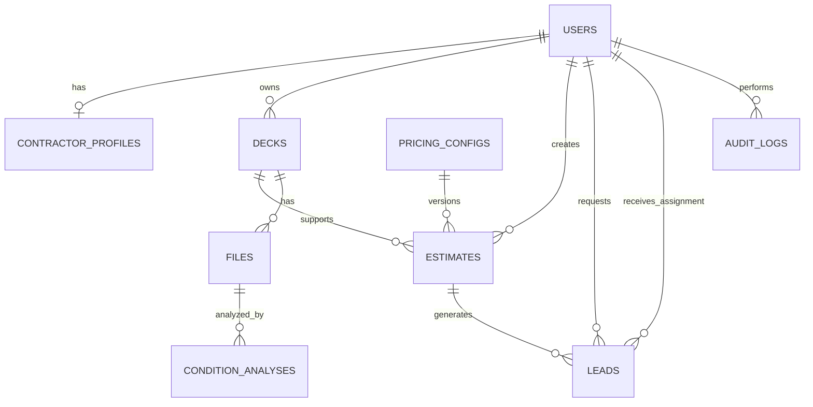

# DECK PRO — Complete High-Level Design (HLD) and Low-Level Design (LLD)

**Document purpose:** Complete technical blueprint for developing the DECK PRO application using the MERN stack.

**Intended reader:** Antigravity AI coding agent and the development team.

**Project status:** Design specification. This document does not imply that the application has already been implemented.

---

# PART A — HIGH-LEVEL DESIGN (HLD)

## 1. Project Overview

DECK PRO is a deck restoration estimation and lead-generation platform. It helps customers estimate deck restoration costs, understand visible deck conditions from photographs when AI analysis is available, save estimates, and request contractor contact.

Contractors can manage their business profiles, access assigned leads, review authorized estimate information, and perform permitted follow-up activities.

Administrators control user management, contractor verification, materials, services, pricing rules, contractor discounts, lead assignment, reports, and audit records.

### Primary objectives

1. Provide a user-friendly deck restoration estimator.
2. Generate estimates using centralized, administrator-approved pricing rules.
3. Store and retrieve estimates securely.
4. Support AI-assisted visual condition analysis as a separate, validated capability.
5. Connect customer requests to verified contractors.
6. Give administrators control over operational and commercial settings.
7. Enforce secure access to data across all three roles.

## 2. Technology Stack

### Frontend
- React
- Vite
- React Router
- A consistent HTTP API client using Fetch or Axios
- Reusable components and form validation

### Backend
- Node.js
- Express.js
- Mongoose ODM
- REST API
- Centralized validation, authorization, and error handling

### Database and storage
- MongoDB Atlas
- MongoDB ObjectId references where appropriate
- Object storage for photographs and generated reports
- Environment variables for connection details and secrets

### Testing and development
- Git and GitHub
- Postman
- Node.js test runner or Vitest/Jest for backend tests
- React Testing Library for frontend tests
- Playwright for end-to-end tests, if included in the development setup

### Optional integrations
- Email verification and notification provider
- AI inference service for deck-condition analysis
- PDF generation library
- Monitoring and error-reporting service

**Architecture decision:** Begin with one modular Express backend and one MongoDB database. Do not introduce microservices, a message queue, or a separate database unless a confirmed requirement justifies them.

## 3. System Architecture



### Architecture explanation

- React presents role-specific interfaces.
- Express exposes the APIs consumed by React.
- Authentication identifies the current user.
- Authorization verifies the user's role, account status, ownership, and assigned permissions.
- Business services enforce pricing, estimate, discount, and lead rules.
- MongoDB stores application records.
- Object storage contains uploaded images and generated files.
- The AI service processes images only when the feature is configured and available.
- PDF and notification services provide additional capabilities.

The backend must remain the source of truth for prices, permissions, estimate records, and lead assignments.

## 4. User Roles

### 4.1 Customer

A customer can:
- Register, verify an account, log in, and manage a profile.
- Enter deck information.
- Upload photographs.
- Request AI-assisted condition analysis when available.
- Generate and save estimates.
- View estimate details and history.
- Download supported reports.
- Request contractor contact.
- View contractor-request status.

A customer cannot modify administrator pricing rules or access another customer's records.

### 4.2 Contractor

A contractor can:
- Register using required personal and business information.
- Submit business and license details for verification.
- View verification status.
- Access authorized, assigned leads.
- Review permitted customer request, deck, photo, and estimate information.
- Perform approved estimate-related operations.
- View applicable discounts.
- Update permitted lead statuses.
- Maintain business profile information.

A contractor cannot change base pricing unless a specific permission is approved. Contractors cannot access unassigned leads or another contractor's restricted records.

### 4.3 Admin

An authorized administrator can:
- View dashboard metrics.
- Manage users and account statuses.
- Approve or reject contractor applications.
- Manage materials and services.
- Configure pricing rules and effective dates.
- Configure contractor discounts.
- Review and assign leads.
- View reports.
- Review audit logs.

Admin account creation must follow a controlled process. Public registration must never grant the Admin role.

## 5. High-Level Business Workflow



AI analysis must not be a prerequisite for pricing unless the business explicitly approves such a dependency. The core estimator should remain usable when the AI service is unavailable, subject to the required input rules.

## 6. High-Level Module Boundaries

| Module | Main responsibility |
|---|---|
| Authentication | Identity, sessions/tokens, verification, recovery |
| Users | Account and profile management |
| Contractor profiles | Business details and verification |
| Decks | Deck information and ownership |
| Files | Secure image/document metadata and access |
| Pricing | Pricing configuration and calculation |
| Estimates | Estimate creation, revisions, history |
| AI analysis | Image analysis requests and results |
| Leads | Customer requests, assignment, status |
| Catalogs | Material and service configuration |
| Discounts | Contractor discount eligibility and calculation |
| Reports | Estimate PDFs and authorized exports |
| Notifications | Required email and event notifications |
| Admin | Administration, reports, operational controls |
| Audit | Important administrative and business events |

---

# PART B — LOW-LEVEL DESIGN (LLD)

## 7. Project Folder Structure

Use a modular structure. The exact filenames can be adjusted, but module boundaries must remain clear.

```text
deck-pro/
├── frontend/
│   ├── src/
│   │   ├── api/
│   │   ├── assets/
│   │   ├── components/
│   │   ├── layouts/
│   │   ├── routes/
│   │   ├── hooks/
│   │   ├── utils/
│   │   ├── features/
│   │   │   ├── auth/
│   │   │   ├── customer/
│   │   │   ├── contractor/
│   │   │   └── admin/
│   │   ├── App.jsx
│   │   └── main.jsx
│   └── package.json
│
├── backend/
│   ├── src/
│   │   ├── config/
│   │   ├── middleware/
│   │   ├── models/
│   │   ├── modules/
│   │   │   ├── auth/
│   │   │   ├── users/
│   │   │   ├── contractors/
│   │   │   ├── decks/
│   │   │   ├── files/
│   │   │   ├── estimates/
│   │   │   ├── pricing/
│   │   │   ├── condition-analysis/
│   │   │   ├── leads/
│   │   │   ├── catalogs/
│   │   │   ├── discounts/
│   │   │   ├── reports/
│   │   │   ├── notifications/
│   │   │   └── admin/
│   │   ├── utils/
│   │   ├── app.js
│   │   └── server.js
│   ├── tests/
│   ├── .env.example
│   ├── .gitignore
│   └── package.json
│
├── docs/
│   ├── HLD.md
│   ├── LLD.md
│   ├── database-schema.md
│   ├── api-specification.md
│   └── testing-plan.md
│
└── README.md
```

### Backend module convention

A module can contain:

- `*.routes.js` — endpoint definitions.
- `*.controller.js` — request/response handling.
- `*.service.js` — business rules and orchestration.
- `*.validation.js` — request schemas.
- `*.test.js` — module tests.

Mongoose models can remain in a shared `models/` directory or live within modules, provided the implementation follows one consistent convention.

Controllers must not duplicate business logic. Pricing calculations, ownership checks, and lead assignment rules must be implemented in reusable backend services and authorization middleware.

## 8. MongoDB Database Design

### 8.1 General database conventions

- Database name: `DECK_PRO`.
- Use MongoDB ObjectIds for internal document identifiers by default.
- Use timestamps for records that need creation/update history.
- Normalize email addresses and other identifiers before uniqueness checks.
- Use Mongoose validation and appropriate database indexes.
- Use references for records that need independent access and lifecycle management.
- Use immutable snapshots for historical calculations that must remain explainable.
- Do not store passwords in plain text.
- Do not store large image binaries in normal application documents by default.
- Avoid hard deletion of business records when it would break auditability or historical estimates.

### 8.2 `users`

Purpose: Common identity and account information.

Fields:

| Field | Type | Rule |
|---|---|---|
| `_id` | ObjectId | Primary identifier |
| `fullName` | String | Required |
| `email` | String | Required, normalized, unique if required by account policy |
| `phone` | String | Required if confirmed by registration requirements |
| `passwordHash` | String | Required for password-based authentication |
| `role` | String enum | `customer`, `contractor`, `admin` |
| `accountStatus` | String enum | `pending_verification`, `active`, `suspended`, `disabled` |
| `emailVerifiedAt` | Date/null | Verification timestamp |
| `phoneVerifiedAt` | Date/null | Verification timestamp |
| `lastLoginAt` | Date/null | Optional |
| `createdAt` | Date | Automatic timestamp |
| `updatedAt` | Date | Automatic timestamp |

Rules:
- Hash passwords using an appropriate password-hashing algorithm.
- Never allow public signup to create an Admin account.
- Do not treat `role` submitted by the browser as authoritative.
- Account activation must follow the required verification policy.
- Decide whether email and phone are globally unique based on the confirmed registration rules.

### 8.3 `contractorProfiles`

Purpose: Contractor business information and verification.

Fields:

- `_id`: ObjectId.
- `userId`: ObjectId reference to `users`, unique for a one-profile-per-contractor design.
- `businessName`: String, required.
- `businessEmail`: String, required if specified by registration policy.
- `businessPhone`: String, required if specified by registration policy.
- `licenseNumber`: String, required.
- `licenseJurisdiction`: String, if applicable.
- `businessAddress`: structured address, with required fields finalized by the business.
- `verificationStatus`: `pending`, `approved`, `rejected`, `suspended`.
- `submittedAt`: Date.
- `reviewedBy`: ObjectId reference to an authorized user.
- `reviewedAt`: Date.
- `rejectionReason`: String, optional.
- `createdAt`, `updatedAt`: Date.

Rules:
- Verify license uniqueness only within the correct jurisdiction where required.
- Restrict lead access until the contractor is approved and active.
- Record who approved or rejected an application.
- Define whether a rejected contractor can resubmit.

### 8.4 `decks`

Purpose: Store saved deck information.

Fields:

- `_id`: ObjectId.
- `customerId`: ObjectId reference to `users`.
- `name`: String, optional label.
- `length`: Number, positive.
- `width`: Number, positive.
- `measurementUnit`: approved unit enum, such as `ft` or `m`.
- `area`: Number, derived and validated by the backend.
- `materialId`: ObjectId reference to `materialCatalog`.
- `selectedServiceIds`: array of ObjectId references to `serviceCatalog`, if multiple services are supported.
- `additionalInputs`: approved structured fields only.
- `createdAt`, `updatedAt`: Date.

Rules:
- Validate dimensions and allowed measurement units.
- Calculate area using a consistent unit system.
- Store the source dimensions so the area can be recalculated.
- Prevent one customer from modifying another customer's deck.

### 8.5 `materialCatalog`

Purpose: Available material definitions.

Fields:

- `_id`: ObjectId.
- `code`: String, unique.
- `name`: String, required.
- `description`: String.
- `coverageUnit`: String, where relevant.
- `isActive`: Boolean.
- `createdBy`, `updatedBy`: ObjectId references to authorized users.
- `createdAt`, `updatedAt`: Date.

Material definitions and material prices must have clearly defined responsibilities. If prices are versioned, keep the authoritative rates in the pricing configuration or a versioned pricing structure rather than maintaining conflicting independent rates.

### 8.6 `serviceCatalog`

Purpose: Available restoration services and coating options.

Fields:

- `_id`: ObjectId.
- `code`: String, unique.
- `name`: String, required.
- `description`: String.
- `category`: approved service category.
- `isActive`: Boolean.
- `createdBy`, `updatedBy`: ObjectId references.
- `createdAt`, `updatedAt`: Date.

Rules:
- Only active services can be selected for new estimates.
- Historical estimates retain their selected service information even if the catalog changes.

### 8.7 `pricingConfigs`

Purpose: Administrator-approved, versioned pricing rules.

Fields:

- `_id`: ObjectId.
- `name`: String.
- `version`: Number or version identifier.
- `status`: `draft`, `active`, `scheduled`, `retired`.
- `effectiveFrom`: Date.
- `effectiveTo`: Date/null.
- `currency`: String, such as `USD` if USD is confirmed as the business currency.
- `rules`: structured pricing configuration.
- `createdBy`, `updatedBy`: ObjectId references.
- `createdAt`, `updatedAt`: Date.

The `rules` structure must explicitly define the approved:
- Material rates.
- Service rates.
- Labor calculation.
- Minimum job price.
- Preparation and waste rules.
- Travel charges.
- Tax rules.
- Rounding rules.
- Pricing precedence and order of operations.

Rules are not approved merely because they appeared in an earlier example. The client must confirm the actual pricing policy.

### 8.8 `estimates`

Purpose: Store individual estimates and preserve their original calculations.

Fields:

- `_id`: ObjectId.
- `estimateNumber`: unique human-readable identifier, if required.
- `customerId`: ObjectId reference to `users`.
- `deckId`: ObjectId reference to `decks`, if applicable.
- `status`: `draft`, `calculated`, `finalized`, `superseded`, `cancelled`.
- `revisionNumber`: Number, if estimate revisions are supported.
- `inputsSnapshot`: validated deck and service inputs used for calculation.
- `pricingConfigId`: ObjectId reference to `pricingConfigs`.
- `pricingVersion`: immutable version identifier.
- `lineItems`: array of structured calculation entries.
- `subtotal`: Number using a consistent monetary representation.
- `discountTotal`: Number.
- `taxTotal`: Number, if applicable.
- `adjustmentTotal`: Number, if applicable.
- `total`: Number.
- `currency`: String.
- `createdAt`, `updatedAt`: Date.
- `finalizedAt`: Date/null.

Each line item should describe the applicable component, quantity, unit, unit rate, and line total. Preserve the actual rates and calculation inputs required to explain the estimate later.

Rules:
- Calculate totals on the backend.
- Do not trust prices supplied by React.
- Do not silently overwrite a finalized estimate when pricing changes.
- Use a revision or superseding-record strategy if revisions are required.
- Use a consistent monetary representation and rounding policy.

### 8.9 `files`

Purpose: Metadata for uploaded images and generated documents.

Fields:

- `_id`: ObjectId.
- `ownerId`: ObjectId reference to `users`.
- `storageProvider`: String.
- `storageKey`: String, required.
- `fileType`: `deck_photo`, `estimate_report`, or another approved category.
- `contentType`: String.
- `sizeBytes`: Number.
- `relatedDeckId`: ObjectId/null.
- `relatedEstimateId`: ObjectId/null.
- `uploadStatus`: `pending`, `uploaded`, `failed`, `deleted`.
- `createdAt`, `updatedAt`: Date.

Rules:
- Store the actual image in approved object storage.
- Verify authorization before issuing access URLs.
- Validate file type and size server-side.
- Never expose private storage credentials or permanent public links for private images.

### 8.10 `conditionAnalyses`

Purpose: Store AI inference results and processing status.

Fields:

- `_id`: ObjectId.
- `ownerId`: ObjectId reference to `users`.
- `deckId`: ObjectId/null.
- `estimateId`: ObjectId/null.
- `fileId`: ObjectId reference to `files`.
- `status`: `pending`, `processing`, `completed`, `failed`, `inconclusive`.
- `modelName`: String.
- `modelVersion`: String.
- `predictions`: array of labels and confidence scores returned by the model.
- `conditionLevel`: optional value from the finalized condition taxonomy.
- `limitations`: array of applicable caveats.
- `errorCode`: optional sanitized error code.
- `requestedAt`: Date.
- `completedAt`: Date/null.

Rules:
- Do not invent predictions when inference has not run.
- Do not label an unvalidated result as reliable.
- Do not infer structural integrity from photographs alone.
- Store only the information needed for product functionality, evaluation, and troubleshooting.

### 8.11 `leads`

Purpose: Customer requests for contractor contact.

Fields:

- `_id`: ObjectId.
- `leadNumber`: unique identifier, if required.
- `customerId`: ObjectId reference to `users`.
- `estimateId`: ObjectId reference to `estimates`.
- `deckId`: ObjectId reference to `decks`, if applicable.
- `status`: `new`, `reviewing`, `assigned`, `contacted`, `in_progress`, `converted`, `closed`, `cancelled`.
- `assignedContractorId`: ObjectId/null, referencing a contractor user.
- `assignedAt`: Date/null.
- `requestDetails`: approved structured information.
- `statusUpdatedAt`: Date.
- `createdAt`, `updatedAt`: Date.

Rules:
- Validate that the customer owns the related estimate.
- Verify that the assigned contractor is approved and active.
- Enforce permitted status transitions.
- Keep assignment history separately if reassignment history must be retained.
- Avoid duplicate requests where the business rules prohibit them.

### 8.12 `discountPlans`

Purpose: Configurable contractor discounts.

Fields:

- `_id`: ObjectId.
- `name`: String.
- `discountType`: `percentage`, `fixed`.
- `discountValue`: Number.
- `eligibilityRules`: structured rules.
- `scope`: approved discount scope.
- `maxDiscount`: Number/null.
- `effectiveFrom`, `effectiveTo`: Date.
- `status`: `draft`, `active`, `retired`.
- `createdBy`, `updatedBy`: ObjectId references.
- `createdAt`, `updatedAt`: Date.

Rules:
- Validate discount eligibility on the backend.
- Apply discount limits and effective dates.
- Define whether the discount applies to materials, labor, or the overall eligible amount.
- Do not assume contractors may edit or override discounts.

### 8.13 `auditLogs`

Purpose: Record significant administrative and business actions.

Fields:

- `_id`: ObjectId.
- `actorId`: ObjectId/null.
- `actorRole`: String, if appropriate.
- `action`: String.
- `targetType`: String.
- `targetId`: ObjectId or appropriate identifier.
- `before`: sanitized object, when required.
- `after`: sanitized object, when required.
- `correlationId`: String, optional.
- `createdAt`: Date.

Rules:
- Record critical pricing changes, contractor approvals, lead assignments, and other designated administrative actions.
- Restrict access to audit logs.
- Prevent normal application operations from editing audit records.
- Exclude passwords, tokens, verification secrets, and unnecessary personal information.

### 8.14 Additional collections

Evaluate these based on final requirements:

- `verificationChallenges` for account-verification and recovery challenges.
- `leadAssignmentHistory` for reassignment and assignment audit.
- `notifications` for delivery state and retry information.
- `reportJobs` if report generation requires asynchronous processing.
- `estimateRevisions` if revisions need independent records.
- `configurationHistory` if historical configuration snapshots require separate storage.

Do not create every optional collection automatically. Document the reason for each collection selected.

## 9. Relationships and Ownership



This diagram is conceptual. It does not replace the detailed schema, and separate assignment-history or revision collections may be required.

### Required ownership rules

- Customers can access only their own protected records.
- Contractors can access only leads and records authorized for their assignment.
- Admin endpoints require authorized administrator privileges.
- Every relevant API must verify record ownership and permissions.
- Guessing an ObjectId must never grant access.
- File retrieval must enforce the same authorization policy as the related record.

## 10. Indexing Requirements

Create indexes based on the final query patterns.

Evaluate:
- Unique normalized email.
- Phone uniqueness, if required.
- Contractor license uniqueness within its jurisdiction, if applicable.
- Customer estimate history by `customerId` and creation date.
- Contractor lead lists by assignment and status.
- Admin lead searches by status and creation date.
- Pricing configurations by status and effective dates.
- Files and AI analyses by relevant references.
- Audit logs by actor, target, and timestamp.

Use compound indexes where they support actual query patterns. Review index performance and avoid unnecessary indexes.

## 11. API Design

Base prefix: `/api/v1`

All endpoints must have documented request schemas, responses, authorization requirements, and error handling.

### 11.1 Authentication APIs

| Method | Endpoint | Purpose |
|---|---|---|
| POST | `/auth/register` | Register customer or contractor |
| POST | `/auth/login` | Authenticate |
| POST | `/auth/logout` | End authenticated session |
| POST | `/auth/verify` | Complete supported verification |
| POST | `/auth/forgot-password` | Start account recovery |
| POST | `/auth/reset-password` | Complete password reset |
| GET | `/auth/me` | Return current authenticated user |

The authentication implementation must choose a consistent session or token strategy and apply appropriate CSRF protection when cookie-based authentication is used.

### 11.2 User and contractor APIs

| Method | Endpoint | Purpose |
|---|---|---|
| GET | `/users/me` | Retrieve own profile |
| PATCH | `/users/me` | Update permitted profile fields |
| GET | `/contractors/me` | Retrieve contractor profile |
| PATCH | `/contractors/me` | Update permitted business fields |
| POST | `/contractors/application` | Submit verification application |
| GET | `/contractors/me/status` | Retrieve verification status |

### 11.3 Deck APIs

| Method | Endpoint | Purpose |
|---|---|---|
| POST | `/decks` | Create deck |
| GET | `/decks` | List own decks |
| GET | `/decks/:id` | Retrieve authorized deck |
| PATCH | `/decks/:id` | Update permitted deck fields |
| DELETE | `/decks/:id` | Delete or archive according to policy |

### 11.4 File APIs

| Method | Endpoint | Purpose |
|---|---|---|
| POST | `/files/upload` | Upload an authorized image |
| GET | `/files/:id` | Retrieve authorized metadata or access URL |
| DELETE | `/files/:id` | Delete according to retention policy |

The implementation may use signed direct uploads to object storage. If so, the backend must authorize the operation and validate the completed upload.

### 11.5 Estimate APIs

| Method | Endpoint | Purpose |
|---|---|---|
| POST | `/estimates` | Create and calculate estimate |
| GET | `/estimates` | List own estimates |
| GET | `/estimates/:id` | Retrieve authorized estimate |
| POST | `/estimates/:id/revisions` | Create a revision, if supported |
| POST | `/estimates/:id/finalize` | Finalize an estimate, if required |
| GET | `/estimates/:id/report` | Generate or retrieve authorized report |

### 11.6 AI APIs

| Method | Endpoint | Purpose |
|---|---|---|
| POST | `/condition-analyses` | Request analysis |
| GET | `/condition-analyses/:id` | Retrieve analysis status and results |

The API must verify access to the referenced image and related deck or estimate.

### 11.7 Lead APIs

| Method | Endpoint | Purpose |
|---|---|---|
| POST | `/leads` | Create contractor-contact request |
| GET | `/leads` | List records allowed for the current role |
| GET | `/leads/:id` | Retrieve authorized lead |
| PATCH | `/leads/:id/status` | Update permitted lead status |
| POST | `/leads/:id/assign` | Admin assigns contractor |
| POST | `/leads/:id/reassign` | Admin reassigns contractor, if supported |

### 11.8 Admin APIs

| Method | Endpoint | Purpose |
|---|---|---|
| GET | `/admin/dashboard` | Retrieve dashboard metrics |
| GET | `/admin/users` | Search and manage users |
| PATCH | `/admin/users/:id/status` | Change permitted account status |
| GET | `/admin/contractors/pending` | List applications awaiting review |
| PATCH | `/admin/contractors/:id/verification` | Approve or reject application |
| CRUD | `/admin/materials` | Manage material catalog |
| CRUD | `/admin/services` | Manage service catalog |
| CRUD | `/admin/pricing-configs` | Manage pricing configurations |
| CRUD | `/admin/discount-plans` | Manage discount plans |
| GET | `/admin/leads` | Review and filter leads |
| GET | `/admin/reports` | Retrieve authorized reports |
| GET | `/admin/audit-logs` | Review audit records |

The table describes API responsibilities, not a complete implementation of every CRUD route. The API specification must define the individual methods and payloads for each supported operation.

## 12. Standard API Response Format

Use consistent response shapes.

Example success:

```json
{
  "success": true,
  "data": {
    "id": "example-estimate-id",
    "status": "calculated"
  }
}
```

Example validation failure:

```json
{
  "success": false,
  "error": {
    "code": "VALIDATION_ERROR",
    "message": "Please correct the invalid input.",
    "details": []
  }
}
```

Recommended HTTP status codes:
- `200`: Successful retrieval or update.
- `201`: Resource created.
- `204`: Successful operation with no response body.
- `400`: Invalid request.
- `401`: Authentication required or invalid.
- `403`: Authenticated but not authorized.
- `404`: Resource not found or intentionally concealed.
- `409`: Conflict or duplicate resource.
- `422`: Semantically invalid request, if adopted consistently.
- `429`: Rate limit exceeded.
- `500`: Unexpected server failure.

Do not expose internal stack traces, credentials, or sensitive database details in production responses.

## 13. Backend Request Lifecycle

All protected endpoints must follow a consistent request flow:

1. Receive the HTTP request.
2. Apply security and request-parsing middleware.
3. Authenticate the current user.
4. Authorize role, account status, and resource access.
5. Validate parameters and request body.
6. Execute controller logic.
7. Call the relevant business service.
8. Read or write MongoDB records.
9. Handle external service calls where required.
10. Return a documented response.
11. Record required operational or audit events.

Business logic must not be duplicated in React and backend controllers. Backend services must be the authoritative implementation.

## 14. Pricing Engine Design

The pricing engine must be independent of the React UI and reusable by estimate-creation and revision workflows.

### Calculation flow

1. Validate deck dimensions and measurement units.
2. Calculate area using the approved unit system.
3. Retrieve the appropriate active pricing configuration.
4. Validate material and service selections.
5. Calculate material charges.
6. Calculate labor and approved preparation charges.
7. Apply approved waste or adjustment rules.
8. Apply minimum-charge rules in the approved order.
9. Apply eligible contractor discounts where applicable.
10. Calculate taxes if required.
11. Apply the approved rounding policy.
12. Return a line-item breakdown and final total.
13. Save the estimate with the relevant pricing version and calculation snapshot.

Do not invent pricing formulas. The client must approve actual rates, calculation order, and adjustment rules.

### Example only

If an approved hypothetical rule uses area multiplied by a material rate, the material subtotal can be calculated from those values. This example is not an approved DECK PRO price.

The final estimate must be calculated by the backend and must not be accepted from a browser-supplied total.

## 15. Estimate Lifecycle

A suggested lifecycle is:

`draft → calculated → finalized`

A revision can supersede an earlier version, and cancellation can be supported where appropriate.

The final lifecycle must be confirmed with the business.

Required behavior:
- Preserve the original calculation inputs.
- Preserve the applicable pricing version and rates.
- Keep historical estimates explainable after pricing changes.
- Define whether finalized estimates can be revised.
- Ensure reports reflect the intended estimate version.

## 16. Lead Lifecycle

Suggested statuses:

`new → reviewing → assigned → contacted → in_progress → converted`

Other supported terminal statuses may include `closed` and `cancelled`.

The application must define:
- Which roles can transition between statuses.
- Whether an assigned contractor can mark a lead as converted.
- Whether reassignment is allowed.
- How duplicate requests are handled.
- Whether status and assignment history must be stored separately.

Enforce these rules on the backend.

## 17. Authentication and Security Design

Implement:
- Password hashing.
- Secure session or token management.
- Account verification and recovery.
- Role-based access control.
- Record ownership checks.
- Request validation.
- Rate limiting.
- Secure HTTP headers and controlled CORS.
- Safe error handling and logging.
- Protected file access.
- Environment-based secrets.
- Audit records for important administrative operations.

Never:
- Store plain-text passwords.
- Put database passwords in source code.
- Commit `.env` files.
- Trust role, price, ownership, or assignment fields merely because the browser submitted them.
- Expose private image URLs without appropriate access controls.
- Allow unverified contractors to bypass approval restrictions.

## 18. Frontend Design

### Public pages
- Home.
- About.
- Services.
- Contact.
- Privacy and Terms.

### Authentication pages
- Signup.
- Login.
- Account recovery and verification.

### Customer pages
1. Customer Dashboard.
2. Deck Estimator.
3. Estimate Details.
4. Estimate History.
5. Contractor Request.
6. My Requests.
7. My Profile and Settings.

The estimator may contain Deck Information, Photo Upload, AI Results, Pricing Results, and Estimate Summary as components rather than separate pages.

### Contractor pages
1. Contractor Dashboard.
2. My Leads.
3. Lead Details.
4. Estimate Management.
5. Business Profile.
6. Account Settings.

### Admin pages
1. Admin Dashboard.
2. User Management.
3. Contractor Verification.
4. Material Catalog.
5. Service Catalog.
6. Pricing Management.
7. Contractor Discount Management.
8. Lead Management.
9. Reports and Audit Logs.

The page list is a planning baseline. Consolidation is acceptable if all approved workflows remain clear and usable.

## 19. Frontend–Backend Integration

React must use a shared API client.

The frontend should:
- Send requests to the documented API endpoints.
- Display backend validation errors.
- Handle loading, empty, success, and error states.
- Use the authenticated identity rather than hardcoding a user role.
- Avoid trusting client-side prices or access checks.
- Refresh or retrieve saved records from the backend where appropriate.

The backend should return consistent response formats and meaningful status codes.

## 20. Error Handling and External Service Failures

Handle:
- MongoDB connection failures.
- Invalid or expired authentication.
- Unauthorized record access.
- File-upload failures.
- AI service timeouts or unavailable service.
- Report-generation errors.
- Invalid pricing configuration.
- Duplicate or conflicting operations.
- Notification delivery failures.

A failed operation must not be reported as successful. Where retries are supported, avoid creating duplicate estimates, leads, or notifications.

## 21. Testing Strategy

### Unit tests
Test:
- Input validation.
- Pricing calculations.
- Discount eligibility.
- Status transitions.
- Utility functions.

### Integration tests
Test:
- Mongoose models and database operations.
- Authentication middleware.
- Ownership and role authorization.
- Estimate persistence.
- Lead assignment.
- File metadata handling.

### API tests
Use Postman and automated API tests to verify:
- Request formats.
- Response formats.
- Status codes.
- Validation.
- Authentication.
- Authorization.
- Error handling.

### Frontend tests
Test:
- Form behavior.
- Navigation.
- Loading and error states.
- Role-specific views.
- API integration.

### End-to-end tests
Verify:
1. Customer creates an account.
2. Customer enters deck information.
3. Backend calculates and saves an estimate.
4. Customer requests contractor contact.
5. Admin assigns a lead.
6. Approved contractor views and updates the lead.
7. Admin can review the resulting operational records.

### Security tests
Test:
- Cross-customer record access.
- Cross-contractor lead access.
- Unverified contractor restrictions.
- Unauthorized Admin API access.
- Invalid file access.
- Manipulated client-side prices.
- Invalid status transitions.

## 22. Deployment Design

Production environment must include:
- React frontend hosting.
- Node.js/Express backend hosting.
- MongoDB Atlas.
- Approved object storage.
- HTTPS and domain configuration.
- Secure production environment variables.
- Controlled database network access.
- Logging and error monitoring.
- Database backup and restoration procedures.
- Health checks and production smoke tests.

Do not deploy using development secrets or unrestricted database access.

## 23. Implementation Order

Antigravity must follow this sequence:

1. Inspect the existing repository before modifying files.
2. Identify what is already implemented and what is missing.
3. Confirm the current architecture and environment.
4. Finalize unresolved schema and business questions.
5. Create the MongoDB schema documentation.
6. Implement and test Mongoose models.
7. Implement database connection and server startup.
8. Implement shared error handling and validation.
9. Implement authentication and authorization.
10. Implement deck management.
11. Implement pricing configuration and pricing service.
12. Implement estimate creation, persistence, and history.
13. Implement secure file uploads.
14. Integrate the Customer estimator.
15. Implement contractor requests and lead creation.
16. Implement Contractor APIs and portal.
17. Implement Admin APIs and portal.
18. Add reports, notifications, and AI integration as approved.
19. Run comprehensive tests and security checks.
20. Prepare deployment and operational documentation.

Features must be developed vertically: backend, database, frontend, and tests should be completed together for each feature before moving on.

## 24. Unresolved Business Decisions

Antigravity must not silently invent answers to the following:

- Final estimator input fields and validation limits.
- Approved material, labor, service, minimum-job, travel, waste, and tax rules.
- Contractor discount eligibility and exact calculation order.
- Estimate finalization and revision policy.
- Lead status transitions and conversion definitions.
- Contractor reassignment and assignment-history requirements.
- AI condition levels, defect taxonomy, and evaluation thresholds.
- Photo upload limits, retention policy, and storage provider.
- Required notification channels.
- Final reporting and export formats.
- Whether email, phone, or both must be verified.
- Whether customer phone numbers and emails must be globally unique.
- Currency and rounding requirements.

If a decision blocks implementation, Antigravity must document the question and ask for clarification. It may use clearly marked temporary assumptions for isolated development, but must not present them as approved production rules.

---

# PART C — ANTIGRAVITY EXECUTION INSTRUCTIONS

## 25. Mandatory Instructions for the AI Coding Agent

You are the development agent responsible for implementing DECK PRO according to this HLD and LLD.

### Before coding
1. Inspect the existing workspace and identify the actual project structure.
2. Read the existing README, package files, source code, and configuration.
3. Preserve working code unless a change is necessary and explained.
4. Compare the repository against this specification.
5. Produce a concise implementation status report identifying completed work, missing work, and blockers.

### During implementation
1. Implement one phase at a time.
2. Explain the purpose of the phase before changing files.
3. Use the agreed MERN architecture.
4. Use modular, maintainable code.
5. Enforce security and authorization in the backend.
6. Never hardcode secrets, real credentials, or unapproved prices.
7. Write tests for important business rules.
8. Run relevant tests after each implementation step.
9. Update documentation when architecture or behavior changes.
10. Report exact files changed and actual test results.

### Before declaring a phase complete
- Confirm the code exists.
- Run the relevant tests.
- Verify the main success path.
- Verify validation and permission failures.
- Report any remaining limitations.

Do not claim a feature is complete if it has only been scaffolded or implemented with static demo data.

### First task to execute

**Do not generate the entire application in one response.**

Begin with the following task:

1. Inspect the current workspace.
2. Report whether the frontend, backend, MongoDB configuration, and project documentation already exist.
3. Identify any conflicts between the current code and this specification.
4. Propose the exact first implementation phase.
5. Wait for approval before making broad or destructive changes.

The immediate development objective is to establish a reliable MongoDB schema and backend foundation, then implement and test the application feature by feature.