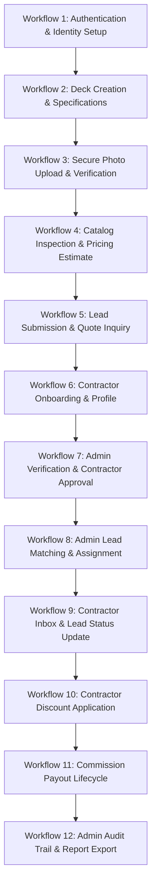

# Deck Estimator — Complete Phase-Wise API Manual Testing Guide

> **Application:** Deck Estimator Platform (RESTful API v1)  
> **Active Branch:** `dev2`  
> **Target Audience:** Manual QA Testers, Postman Engineers, and Developers  
> **Backend Base URL:** `http://localhost:5000`  
> **API Base URL:** `http://localhost:5000/api/v1`  
> **Database:** MongoDB Atlas (`DECK_ESTIMATOR`)  
> **Generated Date:** November 2026  

---

## Table of Contents

1. [Section 1: Testing Environment Setup & Postman Configuration](#section-1-testing-environment-setup--postman-configuration)
2. [Section 2: Phase-Wise API Catalog & Manual Testing Specifications](#section-2-phase-wise-api-catalog--manual-testing-specifications)
   - [Phase 1: Requirements Analysis & Architecture](#phase-1-project-inspection-requirements-analysis-and-architecture)
   - [Phase 2: Backend Foundation & Telemetry](#phase-2-project-structure-application-skeleton-and-backend-foundation)
   - [Phase 3: Authentication and Authorization](#phase-3-authentication-and-authorization)
   - [Phase 4: Deck Input Management and Secure File Uploads](#phase-4-deck-input-management-and-secure-file-uploads)
   - [Phase 5: Material and Service Catalog Management](#phase-5-material-and-service-catalog-management)
   - [Phase 6: Pricing Calculation Engine and Estimate Management](#phase-6-pricing-calculation-engine-and-estimate-management)
   - [Phase 7: AI-Based Deck Condition Analysis](#phase-7-ai-based-deck-condition-analysis)
   - [Phase 8: Contractor Verification and Lead Management](#phase-8-contractor-verification-and-lead-management)
   - [Phase 9: Contractor Discounts and Commission Management](#phase-9-contractor-discounts-and-commission-management)
   - [Phase 10: Administrative Dashboard and Platform Management](#phase-10-administrative-dashboard-and-platform-management)
   - [Phase 11: Integration, Security and Quality Assurance](#phase-11-integration-security-and-quality-assurance)
   - [Phase 12: Deployment, Documentation and Production Readiness](#phase-12-deployment-documentation-and-production-readiness)
3. [Section 3: Phase-Wise Workflow Dependencies & Testing Sequences](#section-3-phase-wise-workflow-dependencies--testing-sequences)
4. [Section 4: Role-Based API Testing Matrix](#section-4-role-based-api-testing-matrix)
5. [Section 5: File Uploads & AI Condition Analysis Testing Guide](#section-5-file-uploads--ai-condition-analysis-testing-guide)
6. [Section 6: Complete API Testing Checklist](#section-6-complete-api-testing-checklist)
7. [Section 7: Missing, Planned & Incomplete API Analysis](#section-7-missing-planned--incomplete-api-analysis)

---

## Section 1: Testing Environment Setup & Postman Configuration

This section provides comprehensive instructions for configuring and executing manual API tests against the Deck Estimator platform using Postman.

### 1.1 Backend Architecture & Base URLs

The application uses an Express.js backend connecting to a live MongoDB Atlas cluster, with optional integration to a Python ML microservice.

- **Backend Host URL:** `http://localhost:5000`
- **API Base URL:** `http://localhost:5000/api/v1`
- **Frontend URL:** `http://localhost:5173` (Vite Dev Server)
- **Database Engine:** MongoDB Atlas (Database: `DECK_ESTIMATOR`)
- **Default Port:** `5000` (Configurable via `backend/.env` variable `PORT`)

### 1.2 How to Start the Backend Server

To start the backend application in development mode:

1. Open PowerShell or a terminal window.
2. Navigate to the project root directory (`e:\DeckEstimator`).
3. Execute the start script:
   ```powershell
   npm start --prefix backend
   ```
4. Observe the terminal output to confirm that database connection and environment variables load properly:
   ```text
   > deck-estimator-backend@0.1.0 start
   > node src/server.js

   ◇ injected env (6) from .env
   [Database] MongoDB Atlas connected successfully (DECK_ESTIMATOR)
   [Server] Environment: development
   [Server] Listening on http://localhost:5000/api/v1
   ```

### 1.3 How to Check Whether the Server Is Running

You can check whether the backend is up and running using any of the following methods:

1. **Browser / Postman Health Check:**
   - URL: `http://localhost:5000/api/v1/health`
   - HTTP Method: `GET`
   - Status: `200 OK`
   - Response Payload:
     ```json
     {
       "success": true,
       "data": {
         "status": "ok",
         "environment": "development",
         "timestamp": "2026-11-02T14:00:00.000Z"
       }
     }
     ```
2. **Terminal Curl / Fetch Verification:**
   ```powershell
   curl http://localhost:5000/api/v1/health
   ```

### 1.4 How to Open Postman and Create a Collection

1. Launch the **Postman** desktop application (or Postman Web Agent).
2. Click **Collections** in the left sidebar navigation.
3. Click the **+** (New Collection) icon.
4. Name the collection: **`Deck Estimator - Manual API Test Suite`**.
5. Add a description: *"Complete phase-by-phase manual API testing suite for Deck Estimator RESTful backend."*

### 1.5 How to Configure Environment Variables

Environment variables allow dynamic sharing of authentication tokens, IDs, and endpoints between requests.

1. Click **Environments** in the left sidebar &rarr; Click **Create Environment**.
2. Name the environment: **`DeckEstimator Dev`**.
3. Define the following variables:

| Variable Name | Initial Value | Current Value | Description / Usage |
| :--- | :--- | :--- | :--- |
| `baseUrl` | `http://localhost:5000/api/v1` | `http://localhost:5000/api/v1` | Common API base URL prefix |
| `customerToken` | *(empty)* | *(auto-populated)* | JWT Bearer token for Customer role |
| `contractorToken` | *(empty)* | *(auto-populated)* | JWT Bearer token for Contractor role |
| `adminToken` | *(empty)* | *(auto-populated)* | JWT Bearer token for Administrator role |
| `deckId` | *(empty)* | *(auto-populated)* | MongoDB `_id` of created Deck project |
| `estimateId` | *(empty)* | *(auto-populated)* | MongoDB `_id` of created Pricing Estimate |
| `leadId` | *(empty)* | *(auto-populated)* | MongoDB `_id` of created Inquiry Lead |
| `contractorId` | *(empty)* | *(auto-populated)* | MongoDB `_id` of Contractor Profile |
| `policyId` | *(empty)* | *(auto-populated)* | MongoDB `_id` of Commission Policy |
| `commissionId` | *(empty)* | *(auto-populated)* | MongoDB `_id` of generated Commission |
| `materialId` | *(empty)* | *(auto-populated)* | MongoDB `_id` of active Material item |
| `serviceId` | *(empty)* | *(auto-populated)* | MongoDB `_id` of active Service item |
| `pricingConfigId`| *(empty)* | *(auto-populated)* | MongoDB `_id` of Pricing Configuration |

4. Select **DeckEstimator Dev** from the top-right environment picker dropdown.

### 1.6 How to Configure Authentication Tokens

The backend supports dual authentication mechanisms:

1. **Authorization Header (Standard REST / Postman Recommended):**
   - Header Name: `Authorization`
   - Value: `Bearer {{customerToken}}` (or `Bearer {{contractorToken}}` / `Bearer {{adminToken}}`)
2. **HttpOnly Session Cookie (`token`):**
   - The backend `POST /api/v1/auth/login` endpoint automatically issues a `Set-Cookie: token=<jwt>; HttpOnly; SameSite=Lax; Path=/` cookie.
   - Postman automatically stores and transmits cookies for `localhost`, but explicit `Authorization: Bearer <token>` headers are recommended for clear role switching during testing.

**Postman Automated Token Capture Script:**
In the `POST /api/v1/auth/login` request, open the **Tests** tab and paste:

```javascript
const res = pm.response.json();
if (res.success && res.data && res.data.token) {
    const userRole = res.data.user.role;
    if (userRole === 'admin') {
        pm.environment.set('adminToken', res.data.token);
        console.log('Admin token saved.');
    } else if (userRole === 'contractor') {
        pm.environment.set('contractorToken', res.data.token);
        console.log('Contractor token saved.');
    } else {
        pm.environment.set('customerToken', res.data.token);
        console.log('Customer token saved.');
    }
}
```

### 1.7 How to Set Common Headers

For every standard JSON endpoint in the collection:

```http
Content-Type: application/json
Accept: application/json
Authorization: Bearer {{customerToken}}
```

You can set these on the Collection level (**Authorization** tab &rarr; Type: **Bearer Token** &rarr; Token: `{{customerToken}}`), or individually per request.

### 1.8 How to Send JSON Requests

1. Choose the HTTP Method (`POST`, `PATCH`, `PUT`).
2. Enter the URL: `{{baseUrl}}/decks`
3. Select the **Body** tab &rarr; Choose the **raw** radio button.
4. Select **JSON** from the format dropdown (located on the right).
5. Paste the valid JSON payload matching the documented Joi validation rules.
6. Click **Send**.

### 1.9 How to Send Multipart/Form-Data Requests for File Uploads

For secure deck photo uploads (`POST /api/v1/decks/:deckId/images`) and contractor verification document uploads (`POST /api/v1/contractors/me/verification/documents`):

1. Set Method: `POST`
2. Set URL: `{{baseUrl}}/decks/{{deckId}}/images`
3. In **Headers**, ensure `Content-Type` is **NOT** manually set (Postman will auto-generate `multipart/form-data; boundary=...`). Ensure `Authorization: Bearer {{customerToken}}` is present.
4. Open the **Body** tab &rarr; Select **form-data**.
5. Add row:
   - **KEY:** `images` (change dropdown on the right of KEY from *Text* to *File*).
   - **VALUE:** Click *Select Files* and choose 1 to 5 image files (`.jpg`, `.png`, or `.webp`, each under 10MB).
6. Optional metadata rows (Type: *Text*):
   - **KEY:** `caption` | **VALUE:** `Backyard deck split surface`
7. Click **Send**.

### 1.10 How to Read HTTP Status Codes and Response Envelopes

Every endpoint adheres to a standardized response structure:

#### Success Envelope (HTTP 200 / 201)
```json
{
  "success": true,
  "data": {
    "id": "6ae87b6db8fa5774ba5b4615",
    "projectName": "Lakefront Cedar Deck",
    "createdAt": "2026-11-02T12:00:00.000Z"
  },
  "meta": {
    "total": 42,
    "page": 1,
    "limit": 10
  }
}
```

#### Error Envelope (HTTP 400 / 401 / 403 / 404 / 409 / 429 / 500)
```json
{
  "success": false,
  "error": {
    "code": "VALIDATION_ERROR",
    "message": "Project name is required",
    "details": [
      {
        "field": "projectName",
        "message": "Project name is required",
        "type": "body"
      }
    ]
  }
}
```

**Quick Status Code Reference:**
- **`200 OK`**: Successful retrieval, update, or deletion.
- **`201 Created`**: New resource persisted to MongoDB Atlas.
- **`400 Bad Request`**: Validation constraint failure (e.g., negative dimension, missing required field).
- **`401 Unauthorized`**: Missing, invalid, or expired JWT session.
- **`403 Forbidden`**: Authenticated user role is not permitted (e.g., customer attempting admin route, or pending contractor accessing locked features).
- **`404 Not Found`**: Referenced resource identifier does not exist.
- **`409 Conflict`**: Duplicate unique key (e.g. duplicate email, duplicate category code, or invalid state transition).
- **`429 Too Many Requests`**: Rate limit reached.
- **`500 Internal Server Error`**: Unhandled server exception.

---


## Section 2: Phase-Wise API Catalog & Manual Testing Specifications

This section documents every endpoint implemented in the Deck Estimator platform mapped across all project phases.

---

### Phase 1: Project Inspection, Requirements Analysis and Architecture

- **Status:** Complete (Planning, System Architecture, & Security Verification Matrix).
- **Associated API Endpoints:** None.
- **Architectural Mapping:** Phase 1 was dedicated to requirement specifications, structural blueprints, and verification matrices. Backend foundation began in Phase 2.

---

### Phase 2: Project Structure, Application Skeleton and Backend Foundation

This phase established the Express application skeleton, global error handling, MongoDB Atlas connection, security middleware, and system telemetry.

#### API-001: Backend API Health & Telemetry Check

- **API Identification:**
  - **API ID:** `API-001`
  - **Phase:** Phase 2 (Foundation)
  - **Module:** Health & Diagnostics
  - **HTTP Method:** `GET`
  - **Endpoint URL:** `http://localhost:5000/api/v1/health`
  - **Controller Reference:** Inline handler in [`backend/src/app.js`](file:///e:/DeckEstimator/backend/src/app.js#L47-L56)
  - **Service Reference:** Direct application response
  - **Authentication Required:** No (Public endpoint)
  - **Allowed User Roles:** All (Public / Unauthenticated)
  - **Purpose:** Verifies that the Express server is running, the Node.js event loop is operational, and reports current environment metadata.
  - **Internal Behavior:** Resolves immediately with HTTP 200, current server timestamp, and runtime environment string (`development`, `test`, or `production`).

- **Required Headers:**
  ```http
  Accept: application/json
  ```

- **Required Parameters:** None.

- **Example Request Data:** No request body.

- **Expected Successful Response (HTTP 200 OK):**
  ```json
  {
    "success": true,
    "data": {
      "status": "ok",
      "environment": "development",
      "timestamp": "2026-11-02T14:15:30.123Z"
    }
  }
  ```

- **Expected Error Responses:**
  - *Server Offline:* If the backend server is stopped, Postman displays `Could not send request: connect ECONNREFUSED 127.0.0.1:5000`. Start server via `npm start --prefix backend`.

- **Database Verification:** None (Stateless telemetry endpoint).

- **Manual Testing Scenarios:**
  1. *Positive Scenario:* Send `GET {{baseUrl}}/health` &rarr; Expect HTTP 200 with `status: "ok"`.
  2. *Method Not Allowed:* Send `POST {{baseUrl}}/health` &rarr; Expect HTTP 404 (Route not mounted for POST).

---

### Phase 3: Authentication and Authorization

This phase implements user identity lifecycle, JWT token issuance, password hashing via bcrypt, role assignment, HttpOnly session cookies, and user profile management.

#### API-002: User Account Registration

- **API Identification:**
  - **API ID:** `API-002`
  - **Phase:** Phase 3 (Auth)
  - **Module:** Authentication
  - **HTTP Method:** `POST`
  - **Endpoint URL:** `http://localhost:5000/api/v1/auth/register`
  - **Controller Reference:** [`backend/src/modules/auth/auth.controller.js`](file:///e:/DeckEstimator/backend/src/modules/auth/auth.controller.js#L14-L35)
  - **Service Reference:** [`backend/src/modules/auth/auth.service.js`](file:///e:/DeckEstimator/backend/src/modules/auth/auth.service.js#L25-L95)
  - **Authentication Required:** No (Public)
  - **Allowed User Roles:** Unauthenticated Guests (Can register as `customer` or `contractor`)
  - **Purpose:** Creates a new account, hashes password using bcrypt, sets default status, issues JWT, and if role is `contractor`, initializes a linked Contractor Profile.
  - **Internal Behavior:** Validates payload against `registerSchema`. Rejects duplicate emails (HTTP 409). Forbids registration with role `admin` (HTTP 400). Hashes password (cost 10). Persists user in MongoDB. For contractors, creates linked `ContractorProfile` with `verificationStatus: "pending"`. Sets `Set-Cookie: token=<jwt>` and returns user object without password hash.

- **Required Headers:**
  ```http
  Content-Type: application/json
  Accept: application/json
  ```

- **Required Parameters (JSON Body):**
  - `fullName` *(string, required)*: 2 to 100 characters.
  - `email` *(string, required)*: Valid RFC email address. Must be unique.
  - `password` *(string, required)*: Minimum 8 characters, maximum 128 characters.
  - `phone` *(string, optional)*: Phone contact number.
  - `role` *(string, optional)*: Allowed: `customer`, `contractor`. Default: `customer`.
  - `businessName` *(string, optional/contractor)*: Required if `role === "contractor"`.
  - `licenseNumber` *(string, optional/contractor)*: Contractor trade license.
  - `licenseJurisdiction` *(string, optional)*: State or jurisdiction code.

- **Example Request Data (Customer):**
  ```json
  {
    "fullName": "Alice Customer",
    "email": "alice.test@example.com",
    "password": "Password123!",
    "phone": "555-123-4567",
    "role": "customer"
  }
  ```

- **Example Request Data (Contractor):**
  ```json
  {
    "fullName": "Robert Builder",
    "email": "robert.contractor@example.com",
    "password": "Password123!",
    "phone": "555-987-6543",
    "role": "contractor",
    "businessName": "Apex Deck Solutions LLC",
    "licenseNumber": "LIC-TX-2026-99",
    "licenseJurisdiction": "TX"
  }
  ```

- **Expected Successful Response (HTTP 201 Created):**
  ```json
  {
    "success": true,
    "data": {
      "user": {
        "id": "6ae87b6db8fa5774ba5b4610",
        "email": "alice.test@example.com",
        "fullName": "Alice Customer",
        "phone": "555-123-4567",
        "role": "customer",
        "accountStatus": "active",
        "createdAt": "2026-11-02T14:20:00.000Z"
      },
      "token": "eyJhbGciOiJIUzI1NiIsInR5cCI6IkpXVCJ9..."
    }
  }
  ```

- **Expected Error Responses:**
  - *Duplicate Email (HTTP 409 Conflict):*
    - Reproduction: Send the same email twice.
    - Payload: `{ "success": false, "error": { "code": "EMAIL_IN_USE", "message": "An account with this email already exists." } }`
  - *Short Password (HTTP 400 Bad Request):*
    - Reproduction: Provide `"password": "123"`.
    - Payload: `{ "success": false, "error": { "code": "VALIDATION_ERROR", "message": "Invalid request parameters." } }`
  - *Privilege Escalation Attempt (HTTP 400 Bad Request):*
    - Reproduction: Provide `"role": "admin"`.
    - Payload: `{ "success": false, "error": { "code": "VALIDATION_ERROR", "details": [{ "field": "role", "message": "Role "admin" is not allowed during public registration." }] } }`

- **Database Verification:**
  - MongoDB Collection: `users`
  - Query: `{ email: "alice.test@example.com" }`
  - Verify: Document created with `passwordHash` (starts with `$2b$10$`), `accountStatus: "active"`, and no plain-text password stored. For contractors, check `contractorProfiles` collection for linked record with `userId: <user_id>`.

- **Manual Testing Scenarios:**
  1. *Positive Customer:* Register unique email &rarr; Expect 201 + JWT + User object.
  2. *Positive Contractor:* Register with `role: "contractor"` + `businessName` &rarr; Expect 201 + profile created.
  3. *Negative Duplicate:* Re-register same email &rarr; Expect 409 Conflict.
  4. *Negative Admin Role:* Provide `"role": "admin"` &rarr; Expect 400 Bad Request.

---

#### API-003: User Login & Session Establishment

- **API Identification:**
  - **API ID:** `API-003`
  - **Phase:** Phase 3 (Auth)
  - **Module:** Authentication
  - **HTTP Method:** `POST`
  - **Endpoint URL:** `http://localhost:5000/api/v1/auth/login`
  - **Controller Reference:** [`backend/src/modules/auth/auth.controller.js`](file:///e:/DeckEstimator/backend/src/modules/auth/auth.controller.js#L37-L55)
  - **Service Reference:** [`backend/src/modules/auth/auth.service.js`](file:///e:/DeckEstimator/backend/src/modules/auth/auth.service.js#L100-L145)
  - **Authentication Required:** No (Public)
  - **Allowed User Roles:** Registered Users (Customer, Contractor, Admin)
  - **Purpose:** Authenticates user credentials, updates `lastLoginAt`, sets HttpOnly cookie, and issues a JWT token.
  - **Internal Behavior:** Looks up user by email. Compares password with bcrypt. Rejects suspended/deactivated users (HTTP 403 / 401). Generates signed JWT containing `{ id, role, email }`. Updates user `lastLoginAt` timestamp. Sets cookie and returns response.

- **Required Headers:**
  ```http
  Content-Type: application/json
  Accept: application/json
  ```

- **Required Parameters (JSON Body):**
  - `email` *(string, required)*: User account email.
  - `password` *(string, required)*: User password.

- **Example Request Data:**
  ```json
  {
    "email": "admin@deckestimator.com",
    "password": "AdminPass123!"
  }
  ```

- **Expected Successful Response (HTTP 200 OK):**
  ```json
  {
    "success": true,
    "data": {
      "user": {
        "id": "6ae87b6db8fa5774ba5b4601",
        "email": "admin@deckestimator.com",
        "fullName": "Platform Administrator",
        "role": "admin",
        "accountStatus": "active",
        "lastLoginAt": "2026-11-02T14:25:00.000Z"
      },
      "token": "eyJhbGciOiJIUzI1NiIsInR5cCI6IkpXVCJ9..."
    }
  }
  ```

- **Expected Error Responses:**
  - *Invalid Credentials (HTTP 401 Unauthorized):*
    - Reproduction: Send wrong password or unregistered email.
    - Payload: `{ "success": false, "error": { "code": "INVALID_CREDENTIALS", "message": "Invalid email or password." } }`
  - *Missing Fields (HTTP 400 Bad Request):*
    - Reproduction: Send `{ "email": "admin@deckestimator.com" }` (missing password).
    - Payload: `{ "success": false, "error": { "code": "VALIDATION_ERROR", "details": [{ "field": "password", "message": "Password is required" }] } }`

- **Database Verification:**
  - MongoDB Collection: `users`
  - Verify field: `lastLoginAt` is updated to current timestamp.

- **Manual Testing Scenarios:**
  1. *Positive Login:* Valid credentials &rarr; Expect 200 OK + JWT.
  2. *Negative Bad Password:* Wrong password &rarr; Expect 401 Unauthorized.
  3. *Negative Unknown Email:* Nonexistent email &rarr; Expect 401 Unauthorized (Prevents user enumeration).

---

#### API-004: User Logout & Session Invalidation

- **API Identification:**
  - **API ID:** `API-004`
  - **Phase:** Phase 3 (Auth)
  - **Module:** Authentication
  - **HTTP Method:** `POST`
  - **Endpoint URL:** `http://localhost:5000/api/v1/auth/logout`
  - **Controller Reference:** [`backend/src/modules/auth/auth.controller.js`](file:///e:/DeckEstimator/backend/src/modules/auth/auth.controller.js#L57-L68)
  - **Service Reference:** Inline clearing of session cookie
  - **Authentication Required:** Optional / All
  - **Allowed User Roles:** All
  - **Purpose:** Clears the HttpOnly authentication session cookie from the client.
  - **Internal Behavior:** Calls `res.clearCookie('token')` and returns success.

- **Required Headers:**
  ```http
  Accept: application/json
  ```

- **Required Parameters:** None.

- **Expected Successful Response (HTTP 200 OK):**
  ```json
  {
    "success": true,
    "data": {
      "message": "Successfully logged out."
    }
  }
  ```

- **Database Verification:** None (Cookie expiration is handled on HTTP layer).

- **Manual Testing Scenarios:**
  1. *Positive Logout:* Send `POST {{baseUrl}}/auth/logout` &rarr; Expect HTTP 200 and `Set-Cookie` with expired timestamp.

---

#### API-005: Retrieve Current Authenticated User Session

- **API Identification:**
  - **API ID:** `API-005`
  - **Phase:** Phase 3 (Auth)
  - **Module:** Authentication
  - **HTTP Method:** `GET`
  - **Endpoint URL:** `http://localhost:5000/api/v1/auth/me`
  - **Controller Reference:** [`backend/src/modules/auth/auth.controller.js`](file:///e:/DeckEstimator/backend/src/modules/auth/auth.controller.js#L70-L82)
  - **Service Reference:** [`backend/src/modules/auth/auth.service.js`](file:///e:/DeckEstimator/backend/src/modules/auth/auth.service.js#L150-L165)
  - **Authentication Required:** Yes (JWT Bearer Token or Cookie)
  - **Allowed User Roles:** `customer`, `contractor`, `admin`
  - **Purpose:** Returns the current profile of the authenticated user. If contractor, includes linked verification status.
  - **Internal Behavior:** Reads user ID from validated JWT. Queries MongoDB `users` collection. If user role is `contractor`, populates `contractorProfile`. Never returns `passwordHash`.

- **Required Headers:**
  ```http
  Authorization: Bearer {{customerToken}}
  Accept: application/json
  ```

- **Expected Successful Response (HTTP 200 OK):**
  ```json
  {
    "success": true,
    "data": {
      "user": {
        "id": "6ae87b6db8fa5774ba5b4610",
        "email": "alice.test@example.com",
        "fullName": "Alice Customer",
        "phone": "555-123-4567",
        "role": "customer",
        "accountStatus": "active",
        "createdAt": "2026-11-02T14:20:00.000Z"
      }
    }
  }
  ```

- **Expected Error Responses:**
  - *No Token (HTTP 401 Unauthorized):* `{ "success": false, "error": { "code": "AUTH_REQUIRED", "message": "Authentication is required to access this resource." } }`
  - *Malformed Token (HTTP 401 Unauthorized):* `{ "success": false, "error": { "code": "INVALID_TOKEN", "message": "Invalid or expired token." } }`

- **Database Verification:** Read-only query to `users`.

- **Manual Testing Scenarios:**
  1. *Positive Check:* Valid customer token &rarr; Expect 200 OK with customer details.
  2. *Negative Missing Auth:* Omit `Authorization` header &rarr; Expect 401 Unauthorized.
  3. *Negative Tampered Token:* Change token string &rarr; Expect 401 Unauthorized.

---

#### API-006: User Profile Details

- **API Identification:**
  - **API ID:** `API-006`
  - **Phase:** Phase 3 (Auth & Users)
  - **Module:** User Profiles
  - **HTTP Method:** `GET`
  - **Endpoint URL:** `http://localhost:5000/api/v1/users/me`
  - **Controller Reference:** [`backend/src/modules/users/users.controller.js`](file:///e:/DeckEstimator/backend/src/modules/users/users.controller.js#L12-L24)
  - **Service Reference:** [`backend/src/modules/users/users.service.js`](file:///e:/DeckEstimator/backend/src/modules/users/users.service.js#L15-L35)
  - **Authentication Required:** Yes
  - **Allowed User Roles:** `customer`, `contractor`, `admin`
  - **Purpose:** Retrieves full profile information for the authenticated user.

- **Required Headers:**
  ```http
  Authorization: Bearer {{customerToken}}
  ```

- **Expected Successful Response (HTTP 200 OK):**
  ```json
  {
    "success": true,
    "data": {
      "id": "6ae87b6db8fa5774ba5b4610",
      "email": "alice.test@example.com",
      "fullName": "Alice Customer",
      "phone": "555-123-4567",
      "role": "customer",
      "accountStatus": "active"
    }
  }
  ```

---

#### API-007: Update User Profile Details

- **API Identification:**
  - **API ID:** `API-007`
  - **Phase:** Phase 3 (Auth & Users)
  - **Module:** User Profiles
  - **HTTP Method:** `PATCH`
  - **Endpoint URL:** `http://localhost:5000/api/v1/users/me`
  - **Controller Reference:** [`backend/src/modules/users/users.controller.js`](file:///e:/DeckEstimator/backend/src/modules/users/users.controller.js#L26-L45)
  - **Service Reference:** [`backend/src/modules/users/users.service.js`](file:///e:/DeckEstimator/backend/src/modules/users/users.service.js#L40-L75)
  - **Authentication Required:** Yes
  - **Allowed User Roles:** `customer`, `contractor`, `admin`
  - **Purpose:** Updates personal details (name, phone). Strictly forbids modification of `role`, `email`, or `accountStatus` (Prevents mass-assignment vulnerabilities).

- **Required Headers:**
  ```http
  Content-Type: application/json
  Authorization: Bearer {{customerToken}}
  ```

- **Required Parameters (JSON Body):**
  - `fullName` *(string, optional)*: 2 to 100 characters.
  - `phone` *(string, optional)*: Phone number.
  - *Forbidden:* `role`, `email`, `accountStatus`, `passwordHash`.

- **Example Request Data:**
  ```json
  {
    "fullName": "Alice Customer-Renovated",
    "phone": "555-999-8888"
  }
  ```

- **Expected Successful Response (HTTP 200 OK):**
  ```json
  {
    "success": true,
    "data": {
      "user": {
        "id": "6ae87b6db8fa5774ba5b4610",
        "email": "alice.test@example.com",
        "fullName": "Alice Customer-Renovated",
        "phone": "555-999-8888",
        "role": "customer"
      }
    }
  }
  ```

- **Expected Error Responses:**
  - *Mass Assignment Escalation Attempt (HTTP 400 Bad Request):*
    - Reproduction: Send `{ "role": "admin" }`.
    - Payload: `{ "success": false, "error": { "code": "VALIDATION_ERROR", "details": [{ "field": "role", "message": ""role" is not allowed" }] } }`

- **Database Verification:**
  - MongoDB Collection: `users`
  - Query: `{ _id: ObjectId("6ae87b6db8fa5774ba5b4610") }`
  - Verify `fullName` is updated; `role` remains unchanged.

---

### Phase 4: Deck Input Management and Secure File Uploads

This phase implements multi-section deck project creation, specification editing, deck deletion, secure photograph uploads (with Multer and memory buffers), private streaming, and image removal.

#### API-008: Create Deck Project

- **API Identification:**
  - **API ID:** `API-008`
  - **Phase:** Phase 4 (Decks)
  - **Module:** Deck Project Management
  - **HTTP Method:** `POST`
  - **Endpoint URL:** `http://localhost:5000/api/v1/decks`
  - **Controller Reference:** [`backend/src/modules/decks/deck.controller.js`](file:///e:/DeckEstimator/backend/src/modules/decks/deck.controller.js#L14-L26)
  - **Service Reference:** [`backend/src/modules/decks/deck.service.js`](file:///e:/DeckEstimator/backend/src/modules/decks/deck.service.js#L18-L65)
  - **Authentication Required:** Yes
  - **Allowed User Roles:** `customer`, `contractor` (must be approved), `admin`
  - **Purpose:** Persists a new deck project with dimensions, location, structural features, and coating condition.
  - **Internal Behavior:** Validates payload against `createDeckSchema`. Sets `ownerId` to `req.user.id`. Rejects client tampering of `ownerId` (HTTP 400). Computes area if length & width provided. Persists to `decks` collection.

- **Required Headers:**
  ```http
  Content-Type: application/json
  Authorization: Bearer {{customerToken}}
  ```

- **Required Parameters (JSON Body):**
  - `projectName` *(string, required)*: 2 to 120 characters.
  - `projectDescription` *(string, optional)*: Max 1000 characters.
  - `propertyAddress` *(object, optional)*: `{ street, city, state, zipCode, country }`.
  - `measurementUnit` *(string, optional)*: `ft` or `m`. Default: `ft`.
  - `deckShape` *(string, optional)*: `rectangle`, `square`, `l_shaped`, `custom`, `other`.
  - `dimensions` *(object, optional)*: `{ length, width, area, isManualArea }`.
  - `structureDetails` *(object, optional)*: `{ levels, isAttached, hasRailings, railingLength, hasStairs, stairStepCount }`.
  - `surfaceDetails` *(object, optional)*: `{ material: 'wood'|'composite'|'other', coatingStatus: 'none'|'painted'|'stained'|'sealed' }`.
  - `visibleConditions` *(array of strings, optional)*: e.g. `["peeling_coating", "wood_damage"]`.
  - `completionStatus` *(string, optional)*: `draft`, `complete`, or `archived`. Default: `draft`.

- **Example Request Data:**
  ```json
  {
    "projectName": "Lakefront Cedar Deck",
    "projectDescription": "Elevated cedar deck overlooking backyard, needing weather seal.",
    "propertyAddress": {
      "street": "742 Evergreen Terrace",
      "city": "Austin",
      "state": "TX",
      "zipCode": "78701",
      "country": "USA"
    },
    "measurementUnit": "ft",
    "deckShape": "rectangle",
    "dimensions": {
      "length": 24,
      "width": 16,
      "area": 384
    },
    "structureDetails": {
      "levels": 1,
      "isAttached": true,
      "hasRailings": true,
      "railingLength": 40,
      "hasStairs": true,
      "stairStepCount": 5
    },
    "surfaceDetails": {
      "material": "wood",
      "coatingStatus": "stained"
    },
    "visibleConditions": ["peeling_coating", "discoloration"],
    "completionStatus": "complete"
  }
  ```

- **Expected Successful Response (HTTP 201 Created):**
  ```json
  {
    "success": true,
    "data": {
      "deck": {
        "id": "6ae87b6db8fa5774ba5b4615",
        "ownerId": "6ae87b6db8fa5774ba5b4610",
        "projectName": "Lakefront Cedar Deck",
        "completionStatus": "complete",
        "dimensions": {
          "length": 24,
          "width": 16,
          "area": 384
        },
        "createdAt": "2026-11-02T14:30:00.000Z"
      }
    }
  }
  ```

- **Postman Test Script (Store Deck ID):**
  ```javascript
  if (pm.response.json().success) {
      pm.environment.set("deckId", pm.response.json().data.deck.id);
  }
  ```

- **Expected Error Responses:**
  - *Missing Project Name (HTTP 400 Bad Request):*
    - Reproduction: Omit `projectName`.
    - Payload: `{ "success": false, "error": { "code": "VALIDATION_ERROR", "details": [{ "field": "projectName", "message": "Project name is required" }] } }`
  - *Setting Owner ID (HTTP 400 Bad Request):*
    - Reproduction: Pass `"ownerId": "..."` in request body.
    - Payload: `{ "success": false, "error": { "code": "VALIDATION_ERROR", "details": [{ "field": "ownerId", "message": "Setting or modifying ownerId is forbidden." }] } }`

- **Database Verification:**
  - MongoDB Collection: `decks`
  - Query: `{ _id: ObjectId("{{deckId}}") }`
  - Verify `ownerId` strictly matches the authenticated user ID.

---

#### API-009: List User Deck Projects

- **API Identification:**
  - **API ID:** `API-009`
  - **Phase:** Phase 4 (Decks)
  - **Module:** Deck Project Management
  - **HTTP Method:** `GET`
  - **Endpoint URL:** `http://localhost:5000/api/v1/decks?page=1&limit=10`
  - **Controller Reference:** [`backend/src/modules/decks/deck.controller.js`](file:///e:/DeckEstimator/backend/src/modules/decks/deck.controller.js#L28-L40)
  - **Service Reference:** [`backend/src/modules/decks/deck.service.js`](file:///e:/DeckEstimator/backend/src/modules/decks/deck.service.js#L70-L105)
  - **Authentication Required:** Yes
  - **Allowed User Roles:** `customer`, `contractor`, `admin`
  - **Purpose:** Returns a paginated list of decks. Customers see only their own decks; admins see all decks.

- **Query Parameters:**
  - `page` *(integer, optional)*: Default `1`.
  - `limit` *(integer, optional)*: Default `10`, max `100`.
  - `status` *(string, optional)*: `draft`, `complete`, or `archived`.

- **Expected Successful Response (HTTP 200 OK):**
  ```json
  {
    "success": true,
    "data": {
      "decks": [
        {
          "id": "6ae87b6db8fa5774ba5b4615",
          "projectName": "Lakefront Cedar Deck",
          "completionStatus": "complete"
        }
      ]
    },
    "meta": {
      "total": 1,
      "page": 1,
      "limit": 10,
      "totalPages": 1
    }
  }
  ```

---

#### API-010: Get Deck Project by Identifier

- **API Identification:**
  - **API ID:** `API-010`
  - **Phase:** Phase 4 (Decks)
  - **HTTP Method:** `GET`
  - **Endpoint URL:** `http://localhost:5000/api/v1/decks/:deckId`
  - **Authentication Required:** Yes
  - **Allowed Roles:** Deck Owner, Assigned Contractor, or Admin (Enforces IDOR Isolation)
  - **Purpose:** Fetches full specifications of a single deck project.
  - **Expected Error on Unauthorized Access (HTTP 403 Forbidden):**
    - Reproduction: Login as User B, request User A's `deckId`.
    - Payload: `{ "success": false, "error": { "code": "FORBIDDEN", "message": "You do not have access to this deck project." } }`

---

#### API-011: Update Deck Project Specifications

- **API Identification:**
  - **API ID:** `API-011`
  - **Phase:** Phase 4 (Decks)
  - **HTTP Method:** `PATCH`
  - **Endpoint URL:** `http://localhost:5000/api/v1/decks/:deckId`
  - **Authentication Required:** Yes
  - **Allowed Roles:** Deck Owner or Admin
  - **Example Request Data:**
    ```json
    {
      "projectName": "Lakefront Cedar Deck - Master Renovation",
      "dimensions": {
        "length": 26,
        "width": 16,
        "area": 416
      }
    }
    ```
  - **Expected Response (HTTP 200 OK):** Returns updated deck document.

---

#### API-012: Delete Deck Project (Soft Delete)

- **API Identification:**
  - **API ID:** `API-012`
  - **Phase:** Phase 4 (Decks)
  - **HTTP Method:** `DELETE`
  - **Endpoint URL:** `http://localhost:5000/api/v1/decks/:deckId`
  - **Authentication Required:** Yes
  - **Allowed Roles:** Deck Owner or Admin
  - **Internal Behavior:** Sets `isDeleted: true` or removes deck and attached image files from disk.
  - **Expected Response (HTTP 200 OK):** `{ "success": true, "data": { "message": "Deck project deleted successfully." } }`

---

#### API-013: Upload Deck Photographs (Multipart/Form-Data)

- **API Identification:**
  - **API ID:** `API-013`
  - **Phase:** Phase 4 (Files & Uploads)
  - **Module:** File Management
  - **HTTP Method:** `POST`
  - **Endpoint URL:** `http://localhost:5000/api/v1/decks/:deckId/images`
  - **Controller Reference:** [`backend/src/modules/files/file.controller.js`](file:///e:/DeckEstimator/backend/src/modules/files/file.controller.js#L20-L45)
  - **Service Reference:** [`backend/src/modules/files/file.service.js`](file:///e:/DeckEstimator/backend/src/modules/files/file.service.js#L30-L90)
  - **Authentication Required:** Yes
  - **Allowed Roles:** Deck Owner, Approved Assigned Contractor, or Admin
  - **Purpose:** Uploads 1 to 5 image files to private disk storage (`backend/uploads/decks`) and creates database metadata records.
  - **Constraints:**
    - Field Name: `images`
    - Supported Formats: `image/jpeg`, `image/png`, `image/webp`
    - Max File Size: 10MB per image
    - Max Images per Deck: 10 total

- **Example Form-Data Request:**
  - `images`: (File binary, e.g. `deck-board.jpg`)
  - `caption`: `Main deck surface weathered cedar`

- **Expected Successful Response (HTTP 201 Created):**
  ```json
  {
    "success": true,
    "data": {
      "images": [
        {
          "id": "6ae87b6db8fa5774ba5b4620",
          "deckId": "6ae87b6db8fa5774ba5b4615",
          "originalFilename": "deck-board.jpg",
          "mimeType": "image/jpeg",
          "fileSizeBytes": 451200,
          "createdAt": "2026-11-02T14:35:00.000Z"
        }
      ]
    }
  }
  ```

- **Expected Error Responses:**
  - *Unsupported Format (HTTP 400 Bad Request):* Upload `.pdf` or `.exe` &rarr; `{ "success": false, "error": { "code": "INVALID_FILE_TYPE", "message": "Only JPEG, PNG, and WebP are accepted." } }`
  - *File Too Large (HTTP 400 Bad Request):* Upload file > 10MB &rarr; `{ "success": false, "error": { "code": "FILE_TOO_LARGE", "message": "One or more files exceed the 10MB limit." } }`

- **Database Verification:**
  - MongoDB Collection: `deckImages`
  - Verify document exists with `deckId` and disk filename.

---

#### API-014: List Uploaded Deck Photographs

- **API Identification:**
  - **API ID:** `API-014`
  - **Phase:** Phase 4 (Files)
  - **HTTP Method:** `GET`
  - **Endpoint URL:** `http://localhost:5000/api/v1/decks/:deckId/images`
  - **Authentication Required:** Yes
  - **Expected Response (HTTP 200 OK):** Returns array of image metadata objects.

---

#### API-015: Serve / Stream Private Deck Image

- **API Identification:**
  - **API ID:** `API-015`
  - **Phase:** Phase 4 (Files)
  - **HTTP Method:** `GET`
  - **Endpoint URL:** `http://localhost:5000/api/v1/decks/:deckId/images/:imageId`
  - **Authentication Required:** Yes
  - **Allowed Roles:** Deck Owner, Assigned Contractor, or Admin (Blocks unauthorized contractors)
  - **Purpose:** Streams binary image data directly to authorized clients.
  - **Expected Response (HTTP 200 OK):** Binary image stream with `Content-Type: image/jpeg` (or png/webp).

---

#### API-016: Delete Deck Photograph

- **API Identification:**
  - **API ID:** `API-016`
  - **Phase:** Phase 4 (Files)
  - **HTTP Method:** `DELETE`
  - **Endpoint URL:** `http://localhost:5000/api/v1/decks/:deckId/images/:imageId`
  - **Authentication Required:** Yes
  - **Allowed Roles:** Deck Owner or Admin
  - **Internal Behavior:** Removes database record and unlinks file from disk storage.
  - **Expected Response (HTTP 200 OK):** `{ "success": true, "data": { "message": "Image deleted successfully." } }`

---

#### API-017: Run Condition Analysis (Deck Shortcut)

- **API Identification:**
  - **API ID:** `API-017`
  - **Phase:** Phase 4 / Phase 7
  - **HTTP Method:** `POST`
  - **Endpoint URL:** `http://localhost:5000/api/v1/decks/:deckId/analyses`
  - **Purpose:** Convenient alias mounted on deck router that triggers AI condition analysis for the deck. (Delegates directly to `conditionAnalysisController.runAnalysis`).

---

#### API-018: List Condition Analyses (Deck Shortcut)

- **API Identification:**
  - **API ID:** `API-018`
  - **Phase:** Phase 4 / Phase 7
  - **HTTP Method:** `GET`
  - **Endpoint URL:** `http://localhost:5000/api/v1/decks/:deckId/analyses`
  - **Purpose:** Retrieves condition analysis records for a specific deck. (Delegates to `conditionAnalysisController.listDeckAnalyses`).

---


### Phase 5: Material and Service Catalog Management

This phase provides administrator catalog management for deck restoration products, manufacturer materials, restoration service definitions, pricing models, and surface compatibility matrices.

---

#### 1. Material Categories APIs

##### API-019: Create Material Category
- **API ID:** `API-019` | **Method:** `POST` | **URL:** `http://localhost:5000/api/v1/catalog/material-categories`
- **Controller:** [`catalog.controller.js`](file:///e:/DeckEstimator/backend/src/modules/catalogs/catalog.controller.js#L14) | **Service:** [`catalog.service.js`](file:///e:/DeckEstimator/backend/src/modules/catalogs/catalog.service.js#L55)
- **Auth:** Admin Only | **Role:** `admin`
- **Headers:** `Content-Type: application/json`, `Authorization: Bearer {{adminToken}}`
- **Request Body:**
  ```json
  {
    "name": "Premium Decking Finishes",
    "description": "High performance stains, sealers, and penetrating oils",
    "displayOrder": 1,
    "status": "active"
  }
  ```
- **Expected Response (HTTP 201 Created):** Returns created category object inside `data.category`.
- **Database:** MongoDB `materialCategories`. Audit log recorded in `auditLogs`.
- **Error:** Duplicate `name` returns HTTP 409 Conflict.

##### API-020: List Material Categories
- **API ID:** `API-020` | **Method:** `GET` | **URL:** `http://localhost:5000/api/v1/catalog/material-categories`
- **Auth:** All authenticated users (`customer`, `contractor`, `admin`).
- **Response (HTTP 200 OK):** Array of material categories with pagination meta.

##### API-021: Get Material Category by ID
- **API ID:** `API-021` | **Method:** `GET` | **URL:** `http://localhost:5000/api/v1/catalog/material-categories/:id`
- **Auth:** Authenticated users | **Response (HTTP 200 OK):** Detailed category object inside `data.category`.

##### API-022: Patch Material Category
- **API ID:** `API-022` | **Method:** `PATCH` | **URL:** `http://localhost:5000/api/v1/catalog/material-categories/:id`
- **Auth:** Admin Only | **Body:** `{ "description": "Updated category notes", "displayOrder": 2 }` | **Response (HTTP 200 OK)**

##### API-023: Put (Replace) Material Category
- **API ID:** `API-023` | **Method:** `PUT` | **URL:** `http://localhost:5000/api/v1/catalog/material-categories/:id`
- **Auth:** Admin Only
- **Request Body:**
  ```json
  {
    "name": "Premium Decking Finishes (Replaced)",
    "description": "Fully updated category description and ordering",
    "displayOrder": 3,
    "status": "active"
  }
  ```
- **Response (HTTP 200 OK):** Replaced category object.

##### API-024: Toggle Material Category Status
- **API ID:** `API-024` | **Method:** `PATCH` | **URL:** `http://localhost:5000/api/v1/catalog/material-categories/:id/status`
- **Auth:** Admin Only
- **Request Body:**
  ```json
  {
    "status": "inactive"
  }
  ```
- **Allowed Status Enum:** `"active"`, `"inactive"`, `"archived"`
- **Response (HTTP 200 OK):** Category with updated status.

---

#### 2. Materials APIs

##### API-025: Create Material Item
- **API ID:** `API-025` | **Method:** `POST` | **URL:** `http://localhost:5000/api/v1/catalog/materials`
- **Controller:** [`catalog.controller.js`](file:///e:/DeckEstimator/backend/src/modules/catalogs/catalog.controller.js#L80) | **Service:** [`catalog.service.js`](file:///e:/DeckEstimator/backend/src/modules/catalogs/catalog.service.js#L180)
- **Auth:** Admin Only
- **Request Body:**
  ```json
  {
    "materialCode": "OLY-MAX-CEDAR",
    "materialName": "Olympic Maximum Semi-Transparent Stain",
    "categoryId": "{{materialCategoryId}}",
    "materialType": "stain",
    "description": "Waterproof exterior deck stain with UV protection",
    "compatibleSurfaces": ["wood"],
    "specifications": {
      "finishType": "semi-gloss",
      "baseType": "oil",
      "dryingTime": 24,
      "recommendedCoats": 2
    },
    "coverage": {
      "coverageValue": 250,
      "coverageAreaUnit": "square_foot",
      "coverageQuantity": 1,
      "coverageQuantityUnit": "gallon"
    },
    "cost": {
      "unitCost": 48.50,
      "currency": "USD",
      "costUnit": "gallon"
    },
    "status": "active"
  }
  ```
- **Response (HTTP 201 Created):** Returns material record with computed coverage and cost metrics.

##### API-026: List Materials
- **API ID:** `API-026` | **Method:** `GET` | **URL:** `http://localhost:5000/api/v1/catalog/materials?surface=wood&status=active`
- **Auth:** Authenticated users | **Response (HTTP 200 OK):** Paginated material items.

##### API-027: Get Material by ID
- **API ID:** `API-027` | **Method:** `GET` | **URL:** `http://localhost:5000/api/v1/catalog/materials/:id`
- **Auth:** Authenticated users | **Response (HTTP 200 OK)**

##### API-028: Patch Material
- **API ID:** `API-028` | **Method:** `PATCH` | **URL:** `http://localhost:5000/api/v1/catalog/materials/:id`
- **Auth:** Admin Only | **Body:** `{ "cost": { "unitCost": 52.00, "currency": "USD", "costUnit": "gallon" }, "description": "Updated material notes" }` | **Response (HTTP 200 OK)**

##### API-029: Put (Replace) Material
- **API ID:** `API-029` | **Method:** `PUT` | **URL:** `http://localhost:5000/api/v1/catalog/materials/:id`
- **Auth:** Admin Only | **Request Body:** Complete replacement material payload with `materialName`, `categoryId`, `materialType`, `cost`, `coverage`, and `specifications`. | **Response (HTTP 200 OK)**

##### API-030: Update Material Status
- **API ID:** `API-030` | **Method:** `PATCH` | **URL:** `http://localhost:5000/api/v1/catalog/materials/:id/status`
- **Auth:** Admin Only | **Body:** `{ "status": "inactive" }` | **Allowed Enum:** `"active"`, `"inactive"`, `"archived"` | **Response (HTTP 200 OK)**

---

#### 3. Service Categories APIs

##### API-031: Create Service Category
- **API ID:** `API-031` | **Method:** `POST` | **URL:** `http://localhost:5000/api/v1/catalog/service-categories`
- **Auth:** Admin Only
- **Request Body:**
  ```json
  {
    "categoryName": "Surface Preparation",
    "categoryCode": "SRV_PREP",
    "description": "Cleaning, power washing, and chemical stripping services",
    "displayOrder": 1,
    "isActive": true
  }
  ```
- **Response (HTTP 201 Created)**

##### API-032: List Service Categories
- **API ID:** `API-032` | **Method:** `GET` | **URL:** `http://localhost:5000/api/v1/catalog/service-categories`
- **Auth:** Authenticated users | **Response (HTTP 200 OK)**

##### API-033: Get Service Category by ID
- **API ID:** `API-033` | **Method:** `GET` | **URL:** `http://localhost:5000/api/v1/catalog/service-categories/:id`
- **Auth:** Authenticated users | **Response (HTTP 200 OK)**

##### API-034: Patch Service Category
- **API ID:** `API-034` | **Method:** `PATCH` | **URL:** `http://localhost:5000/api/v1/catalog/service-categories/:id`
- **Auth:** Admin Only | **Response (HTTP 200 OK)**

##### API-035: Put Service Category
- **API ID:** `API-035` | **Method:** `PUT` | **URL:** `http://localhost:5000/api/v1/catalog/service-categories/:id`
- **Auth:** Admin Only | **Response (HTTP 200 OK)**

##### API-036: Update Service Category Status
- **API ID:** `API-036` | **Method:** `PATCH` | **URL:** `http://localhost:5000/api/v1/catalog/service-categories/:id/status`
- **Auth:** Admin Only | **Response (HTTP 200 OK)**

---

#### 4. Services APIs

##### API-037: Create Service Item
- **API ID:** `API-037` | **Method:** `POST` | **URL:** `http://localhost:5000/api/v1/catalog/services`
- **Controller:** [`catalog.controller.js`](file:///e:/DeckEstimator/backend/src/modules/catalogs/catalog.controller.js#L230) | **Service:** [`catalog.service.js`](file:///e:/DeckEstimator/backend/src/modules/catalogs/catalog.service.js#L420)
- **Auth:** Admin Only
- **Request Body:**
  ```json
  {
    "categoryId": "{{serviceCategoryId}}",
    "serviceName": "High Pressure Deck Wash & Brighten",
    "serviceCode": "SRV_WASH_BRIGHT",
    "description": "Deep power wash and oxalic acid brightening",
    "pricingModel": "per_sq_ft",
    "basePrice": 0.45,
    "estimatedHours": 3.5,
    "laborSkillLevel": "standard",
    "status": "active"
  }
  ```
- **Response (HTTP 201 Created)**

##### API-038: List Services
- **API ID:** `API-038` | **Method:** `GET` | **URL:** `http://localhost:5000/api/v1/catalog/services?status=active`
- **Auth:** Authenticated users | **Response (HTTP 200 OK)**

##### API-039: Get Service by ID
- **API ID:** `API-039` | **Method:** `GET` | **URL:** `http://localhost:5000/api/v1/catalog/services/:id`
- **Auth:** Authenticated users | **Response (HTTP 200 OK)**

##### API-040: Patch Service
- **API ID:** `API-040` | **Method:** `PATCH` | **URL:** `http://localhost:5000/api/v1/catalog/services/:id`
- **Auth:** Admin Only | **Response (HTTP 200 OK)**

##### API-041: Put Service
- **API ID:** `API-041` | **Method:** `PUT` | **URL:** `http://localhost:5000/api/v1/catalog/services/:id`
- **Auth:** Admin Only | **Response (HTTP 200 OK)**

##### API-042: Update Service Status
- **API ID:** `API-042` | **Method:** `PATCH` | **URL:** `http://localhost:5000/api/v1/catalog/services/:id/status`
- **Auth:** Admin Only | **Response (HTTP 200 OK)**

---

#### 5. Compatibility Matrix APIs

##### API-043: Create Material-Service Compatibility
- **API ID:** `API-043` | **Method:** `POST` | **URL:** `http://localhost:5000/api/v1/catalog/compatibilities`
- **Auth:** Admin Only
- **Request Body:**
  ```json
  {
    "materialId": "{{materialId}}",
    "serviceId": "{{serviceId}}",
    "compatibilityStatus": "compatible",
    "notes": "Surface wash required prior to penetrating oil application"
  }
  ```
- **Response (HTTP 201 Created)**

##### API-044: List Compatibilities
- **API ID:** `API-044` | **Method:** `GET` | **URL:** `http://localhost:5000/api/v1/catalog/compatibilities`
- **Auth:** Authenticated users | **Response (HTTP 200 OK)**

##### API-045: Get Compatibility by ID
- **API ID:** `API-045` | **Method:** `GET` | **URL:** `http://localhost:5000/api/v1/catalog/compatibilities/:id`
- **Auth:** Authenticated users | **Response (HTTP 200 OK)**

##### API-046: Patch Compatibility
- **API ID:** `API-046` | **Method:** `PATCH` | **URL:** `http://localhost:5000/api/v1/catalog/compatibilities/:id`
- **Auth:** Admin Only | **Response (HTTP 200 OK)**

##### API-047: Put Compatibility
- **API ID:** `API-047` | **Method:** `PUT` | **URL:** `http://localhost:5000/api/v1/catalog/compatibilities/:id`
- **Auth:** Admin Only | **Response (HTTP 200 OK)**

##### API-048: Delete Compatibility Link
- **API ID:** `API-048` | **Method:** `DELETE` | **URL:** `http://localhost:5000/api/v1/catalog/compatibilities/:id`
- **Auth:** Admin Only | **Response (HTTP 200 OK)**

---

### Phase 6: Pricing Calculation Engine and Estimate Management

This phase computes deterministic pricing estimates based on deck geometry, active catalog prices, labor rates, travel adjustments, minimum project price floors, and tax rates.

---

#### 1. Pricing Configurations APIs

##### API-049: Get Active Pricing Configuration
- **API ID:** `API-049` | **Method:** `GET` | **URL:** `http://localhost:5000/api/v1/pricing/configurations/active`
- **Auth:** Authenticated users (`customer`, `contractor`, `admin`)
- **Purpose:** Fetches the currently active platform pricing parameters (labor rate, minimum job price floor, travel fee, tax rate, waste margin).
- **Expected Response (HTTP 200 OK):**
  ```json
  {
    "success": true,
    "data": {
      "configuration": {
        "id": "6ae87b6db8fa5774ba5b4630",
        "name": "Standard Regional Rate 2026",
        "laborRate": 65.00,
        "minimumJobPrice": 350.00,
        "travelCharge": 45.00,
        "taxPercentage": 8.25,
        "wastePercentage": 10.0,
        "additionalCoatingPrice": 0.25,
        "status": "ACTIVE"
      }
    }
  }
  ```

##### API-050: Create Pricing Configuration
- **API ID:** `API-050` | **Method:** `POST` | **URL:** `http://localhost:5000/api/v1/pricing/configurations`
- **Auth:** Admin Only
- **Request Body:**
  ```json
  {
    "name": "Q4 Commercial Restoration Matrix",
    "laborRate": 75.00,
    "minimumJobPrice": 450.00,
    "travelCharge": 50.00,
    "taxPercentage": 8.25,
    "wastePercentage": 12.0,
    "additionalCoatingPrice": 0.35,
    "description": "Updated commercial labor pricing",
    "effectiveFrom": "2026-11-01T00:00:00.000Z"
  }
  ```
- **Response (HTTP 201 Created)**

##### API-051: List Pricing Configurations
- **API ID:** `API-051` | **Method:** `GET` | **URL:** `http://localhost:5000/api/v1/pricing/configurations`
- **Auth:** Admin Only | **Response (HTTP 200 OK)**

##### API-052: Get Pricing Configuration by ID
- **API ID:** `API-052` | **Method:** `GET` | **URL:** `http://localhost:5000/api/v1/pricing/configurations/:id`
- **Auth:** Admin Only | **Response (HTTP 200 OK)**

##### API-053: Patch Pricing Configuration
- **API ID:** `API-053` | **Method:** `PATCH` | **URL:** `http://localhost:5000/api/v1/pricing/configurations/:id`
- **Auth:** Admin Only | **Response (HTTP 200 OK)**

##### API-054: Activate Pricing Configuration
- **API ID:** `API-054` | **Method:** `PATCH` | **URL:** `http://localhost:5000/api/v1/pricing/configurations/:id/status`
- **Auth:** Admin Only | **Body:** `{ "status": "ACTIVE" }`
- **Internal Behavior:** Sets selected configuration to `ACTIVE` and archives previously active configurations.

---

#### 2. Estimates Management APIs

##### API-055: Create & Calculate Pricing Estimate
- **API ID:** `API-055` | **Method:** `POST` | **URL:** `http://localhost:5000/api/v1/estimates`
- **Controller:** [`estimate.controller.js`](file:///e:/DeckEstimator/backend/src/modules/estimates/estimate.controller.js#L14) | **Service:** [`estimate.service.js`](file:///e:/DeckEstimator/backend/src/modules/estimates/estimate.service.js#L80)
- **Auth:** Deck Owner, Approved Contractor, or Admin
- **Request Body:**
  ```json
  {
    "deckId": "{{deckId}}",
    "estimateName": "Spring Full Seal & Clean",
    "materialIds": ["{{materialId}}"],
    "serviceIds": ["{{serviceId}}"],
    "numberOfCoats": 2,
    "notes": "Customer requesting low odor sealer"
  }
  ```
- **Internal Behavior:**
  1. Validates deck ownership/assignment.
  2. Pulls active catalog material and service pricing.
  3. Checks compatibility rules.
  4. Runs deterministic formula via `pricingEngine.js` (Waste multiplier + Labor + Travel + Subtotal + Tax).
  5. Applies `minimumJobPrice` floor adjustment if subtotal + tax < minimum.
  6. Generates unique human-readable `estimateNumber` (e.g. `EST-20261102-A9F1B2`).
  7. Persists initial version to `estimateRevisions` history table.
- **Expected Successful Response (HTTP 201 Created):**
  ```json
  {
    "success": true,
    "data": {
      "estimate": {
        "id": "6ae87b79b8fa5774ba5b4616",
        "estimateNumber": "EST-20261102-A9F1B2",
        "deckId": "6ae87b6db8fa5774ba5b4615",
        "estimateStatus": "DRAFT",
        "pricingSummary": {
          "materialsCost": 97.00,
          "servicesCost": 172.80,
          "laborCost": 227.50,
          "travelCharge": 45.00,
          "subtotal": 542.30,
          "taxAmount": 44.74,
          "minimumPriceAdjustment": 0.00,
          "totalCost": 587.04
        },
        "createdAt": "2026-11-02T14:40:00.000Z"
      }
    }
  }
  ```
- **Postman Test Script:** `pm.environment.set("estimateId", pm.response.json().data.estimate.id);`

##### API-056: List Estimates
- **API ID:** `API-056` | **Method:** `GET` | **URL:** `http://localhost:5000/api/v1/estimates?page=1&limit=10`
- **Auth:** Authenticated users | **Response (HTTP 200 OK):** Paginated estimate summaries.

##### API-057: Get Estimate by ID
- **API ID:** `API-057` | **Method:** `GET` | **URL:** `http://localhost:5000/api/v1/estimates/:id`
- **Auth:** Deck Owner, Assigned Contractor, or Admin | **Response (HTTP 200 OK):** Complete line item breakdown.

##### API-058: Recalculate Estimate (Revision)
- **API ID:** `API-058` | **Method:** `POST` | **URL:** `http://localhost:5000/api/v1/estimates/:id/recalculate`
- **Auth:** Deck Owner or Admin
- **Request Body:**
  ```json
  {
    "materialIds": ["{{materialId}}"],
    "serviceIds": ["{{serviceId}}"],
    "revisionReason": "Customer added additional pressure washing service"
  }
  ```
- **Response (HTTP 200 OK):** Returns updated estimate with incremented version in `estimateRevisions`.

##### API-059: Get Estimate Audit History
- **API ID:** `API-059` | **Method:** `GET` | **URL:** `http://localhost:5000/api/v1/estimates/:id/history`
- **Auth:** Authenticated users with estimate access
- **Response (HTTP 200 OK):** Chronological log of revisions, author, reason, and subtotal changes.

##### API-060: Update Estimate Status
- **API ID:** `API-060` | **Method:** `PATCH` | **URL:** `http://localhost:5000/api/v1/estimates/:id/status`
- **Auth:** Authenticated users with estimate access
- **Request Body:** `{ "estimateStatus": "SUBMITTED", "notes": "Approved by homeowner" }`
- **Allowed Statuses:** `DRAFT`, `SUBMITTED`, `COMPLETED`, `EXPIRED`, `CANCELLED`.
- **Response (HTTP 200 OK)**

---


### Phase 7: AI-Based Deck Condition Analysis

This phase integrates visual deck surface telemetry with an external Python ML service (or internal heuristic fallback) to classify wood weathering, coating degradation, mold, and damage.

---

#### API-061: ML Microservice Health Check
- **API ID:** `API-061` | **Method:** `GET` | **URL:** `http://localhost:5000/api/v1/condition-analyses/ml-health`
- **Controller:** [`conditionAnalysis.controller.js`](file:///e:/DeckEstimator/backend/src/modules/condition-analysis/conditionAnalysis.controller.js#L18)
- **Auth:** Authenticated users (`customer`, `contractor`, `admin`)
- **Purpose:** Probes the Python FastAPI microservice at `http://localhost:5001/health`.
- **Expected Response (HTTP 200 OK):**
  ```json
  {
    "success": true,
    "data": {
      "mlService": {
        "status": "healthy",
        "url": "http://localhost:5001",
        "responseTimeMs": 14
      }
    }
  }
  ```

#### API-062: Run AI Condition Analysis for Deck
- **API ID:** `API-062` | **Method:** `POST` | **URL:** `http://localhost:5000/api/v1/condition-analyses/decks/:deckId/analyses`
- **Controller:** [`conditionAnalysis.controller.js`](file:///e:/DeckEstimator/backend/src/modules/condition-analysis/conditionAnalysis.controller.js#L30) | **Service:** [`conditionAnalysis.service.js`](file:///e:/DeckEstimator/backend/src/modules/condition-analysis/conditionAnalysis.service.js#L45)
- **Auth:** Deck Owner, Assigned Contractor, or Admin
- **Request Body (Optional):** `{ "forceFresh": false }`
- **Internal Behavior:**
  1. Checks if deck has uploaded photos.
  2. Dispatches image files to ML service or rule-based vision evaluator.
  3. Classifies weathering grade (`light`, `moderate`, `severe`), coating peeling percentage, splintering risk, and recommended service actions.
  4. Persists record in `conditionAnalyses` collection.
- **Expected Response (HTTP 201 Created):**
  ```json
  {
    "success": true,
    "data": {
      "analysis": {
        "id": "6ae87b79b8fa5774ba5b4640",
        "deckId": "6ae87b6db8fa5774ba5b4615",
        "overallCondition": "moderate_wear",
        "confidenceScore": 0.91,
        "findings": [
          { "condition": "peeling_coating", "severity": "moderate", "confidence": 0.88 },
          { "condition": "graying_wood", "severity": "high", "confidence": 0.94 }
        ],
        "recommendedServices": ["High Pressure Deck Wash & Brighten", "Two-Coat Protective Seal"],
        "status": "completed",
        "createdAt": "2026-11-02T14:45:00.000Z"
      }
    }
  }
  ```

#### API-063: List Deck Condition Analyses
- **API ID:** `API-063` | **Method:** `GET` | **URL:** `http://localhost:5000/api/v1/condition-analyses/decks/:deckId/analyses`
- **Auth:** Authenticated users with deck access | **Response (HTTP 200 OK):** Array of historical telemetry analyses.

#### API-064: Get Condition Analysis by ID
- **API ID:** `API-064` | **Method:** `GET` | **URL:** `http://localhost:5000/api/v1/condition-analyses/:id`
- **Auth:** Authenticated users with deck access | **Response (HTTP 200 OK):** Detailed findings and image bounding coordinates.

#### API-065: Retry Failed Condition Analysis
- **API ID:** `API-065` | **Method:** `POST` | **URL:** `http://localhost:5000/api/v1/condition-analyses/:id/retry`
- **Auth:** Deck Owner or Admin
- **Purpose:** Retries image analysis if initial dispatch encountered microservice timeout or network error.

#### API-066: Review / Override AI Condition Analysis
- **API ID:** `API-066` | **Method:** `PATCH` | **URL:** `http://localhost:5000/api/v1/condition-analyses/:id/review`
- **Auth:** Admin Only
- **Request Body:**
  ```json
  {
    "reviewedStatus": "approved",
    "overrideNotes": "Verified by structural estimator: surface wear is moderate, no dry rot detected."
  }
  ```
- **Response (HTTP 200 OK)**

---

### Phase 8: Contractor Verification and Lead Management

This phase handles contractor onboarding, compliance license verification, inbound quotation inquiries (Leads), automated eligibility matching, contractor inbox, and lead status progression.

---

#### 1. Contractor Profile & Verification APIs

##### API-067: Get Current Contractor Profile
- **API ID:** `API-067` | **Method:** `GET` | **URL:** `http://localhost:5000/api/v1/contractors/me`
- **Auth:** Contractor Only (`contractor`)
- **Response (HTTP 200 OK):** Contractor profile, company details, service radius, and verification badge status.

##### API-068: Update Contractor Profile
- **API ID:** `API-068` | **Method:** `PATCH` | **URL:** `http://localhost:5000/api/v1/contractors/me`
- **Auth:** Contractor Only
- **Request Body:**
  ```json
  {
    "businessName": "Apex Deck Solutions LLC",
    "phone": "555-987-6543",
    "serviceRadiusMiles": 35,
    "specialties": ["wood_restoration", "composite_cleaning", "structural_repair"]
  }
  ```
- **Response (HTTP 200 OK)**

##### API-069: Submit Contractor Verification Application
- **API ID:** `API-069` | **Method:** `POST` | **URL:** `http://localhost:5000/api/v1/contractors/me/verification/submit`
- **Auth:** Contractor Only
- **Request Body:**
  ```json
  {
    "businessRegistrationNumber": "BRN-TX-88992",
    "insurancePolicyNumber": "POL-GL-2026-001",
    "insuranceExpiryDate": "2027-11-01T00:00:00.000Z",
    "yearsInBusiness": 8
  }
  ```
- **Internal Behavior:** Transitions verification status from `PENDING` to `SUBMITTED` (or notifies Admin queue).

##### API-070: Upload Contractor Verification Document
- **API ID:** `API-070` | **Method:** `POST` | **URL:** `http://localhost:5000/api/v1/contractors/me/verification/documents`
- **Auth:** Contractor Only (Multipart/form-data)
- **Parameters:** `document` (File), `documentType` (`liability_insurance`, `trade_license`, `w9_form`).
- **Response (HTTP 201 Created)**

##### API-071: List Contractor Uploaded Documents
- **API ID:** `API-071` | **Method:** `GET` | **URL:** `http://localhost:5000/api/v1/contractors/me/verification/documents`
- **Auth:** Contractor Only | **Response (HTTP 200 OK)**

##### API-072: Serve Contractor Verification Document File
- **API ID:** `API-072` | **Method:** `GET` | **URL:** `http://localhost:5000/api/v1/contractors/documents/:documentId/file`
- **Auth:** Document Owner or Admin (Blocks other contractors)
- **Response (HTTP 200 OK):** File stream.

##### API-073: List Eligible Approved Contractors
- **API ID:** `API-073` | **Method:** `GET` | **URL:** `http://localhost:5000/api/v1/contractors/eligible`
- **Auth:** Admin Only
- **Purpose:** Lists active, approved contractors eligible for lead assignment.

##### API-074: Admin List Contractor Verification Applications
- **API ID:** `API-074` | **Method:** `GET` | **URL:** `http://localhost:5000/api/v1/contractors/admin/verifications?status=PENDING`
- **Auth:** Admin Only | **Response (HTTP 200 OK):** Verification queue.

##### API-075: Admin Get Contractor Verification Details
- **API ID:** `API-075` | **Method:** `GET` | **URL:** `http://localhost:5000/api/v1/contractors/admin/verifications/:id`
- **Auth:** Admin Only | **Response (HTTP 200 OK)**

##### API-076: Admin Review & Approve/Reject Contractor
- **API ID:** `API-076` | **Method:** `POST` | **URL:** `http://localhost:5000/api/v1/contractors/admin/verifications/:id/review`
- **Auth:** Admin Only
- **Request Body:**
  ```json
  {
    "action": "approve",
    "reviewNotes": "All Texas trade licenses and general liability policies validated."
  }
  ```
- **Internal Behavior:** Updates `verificationStatus` to `approved`. Unlocks contractor dashboard and lead assignment.
- **Response (HTTP 200 OK)**

---

#### 2. Customer Leads & Inquiries APIs

##### API-077: Create Customer Lead (Quote Inquiry)
- **API ID:** `API-077` | **Method:** `POST` | **URL:** `http://localhost:5000/api/v1/leads`
- **Controller:** [`lead.controller.js`](file:///e:/DeckEstimator/backend/src/modules/leads/lead.controller.js#L14) | **Service:** [`lead.service.js`](file:///e:/DeckEstimator/backend/src/modules/leads/lead.service.js#L30)
- **Auth:** Customer Only (`customer`)
- **Request Body:**
  ```json
  {
    "deckId": "{{deckId}}",
    "estimateId": "{{estimateId}}",
    "leadSource": "customer_estimator",
    "enquiry": {
      "subject": "Cedar Deck Weather Seal Quote",
      "message": "Looking for a contractor to inspect wood splinters and apply two coats.",
      "preferredContactMethod": "email",
      "preferredContactTime": "Weekdays 2-5 PM",
      "additionalNotes": "Gate code is #1234"
    }
  }
  ```
- **Expected Response (HTTP 201 Created):**
  ```json
  {
    "success": true,
    "data": {
      "lead": {
        "id": "6ae87b79b8fa5774ba5b4650",
        "leadNumber": "LEAD-20261102-B8E2",
        "status": "new",
        "deckId": "6ae87b6db8fa5774ba5b4615",
        "createdAt": "2026-11-02T14:50:00.000Z"
      }
    }
  }
  ```
- **Postman Test Script:** `pm.environment.set("leadId", pm.response.json().data.lead.id);`

##### API-078: Customer List Own Leads
- **API ID:** `API-078` | **Method:** `GET` | **URL:** `http://localhost:5000/api/v1/leads/my-leads`
- **Auth:** Customer Only | **Response (HTTP 200 OK)**

##### API-079: Admin List All Platform Leads
- **API ID:** `API-079` | **Method:** `GET` | **URL:** `http://localhost:5000/api/v1/leads/admin/all?page=1&limit=10`
- **Auth:** Admin Only | **Response (HTTP 200 OK)**

##### API-080: Admin Lead Analytics & Metrics
- **API ID:** `API-080` | **Method:** `GET` | **URL:** `http://localhost:5000/api/v1/leads/admin/analytics`
- **Auth:** Admin Only | **Response (HTTP 200 OK):** Conversion rates, leads by status, avg response time.

##### API-081: Admin Assign Lead to Contractor
- **API ID:** `API-081` | **Method:** `POST` | **URL:** `http://localhost:5000/api/v1/leads/admin/:id/assign`
- **Auth:** Admin Only
- **Request Body:**
  ```json
  {
    "contractorId": "{{contractorId}}",
    "assignmentNotes": "Assigned to Apex Deck Solutions - local Austin specialist"
  }
  ```
- **Internal Behavior:** Sets `assignedContractorId` to contractor ID and status to `assigned`.
- **Response (HTTP 200 OK)**

##### API-082: Admin Close Lead
- **API ID:** `API-082` | **Method:** `POST` | **URL:** `http://localhost:5000/api/v1/leads/admin/:id/close`
- **Auth:** Admin Only
- **Request Body:** `{ "reason": "Customer cancelled project", "closeNotes": "Project postponed to next year" }`
- **Response (HTTP 200 OK)**

##### API-083: Admin Get Lead Lifecycle History
- **API ID:** `API-083` | **Method:** `GET` | **URL:** `http://localhost:5000/api/v1/leads/admin/:id/history`
- **Auth:** Admin Only | **Response (HTTP 200 OK)**

##### API-084: Contractor Lead Inbox
- **API ID:** `API-084` | **Method:** `GET` | **URL:** `http://localhost:5000/api/v1/leads/contractor/inbox`
- **Auth:** Approved Contractor Only (`contractor`)
- **Response (HTTP 200 OK):** Array of leads matched and assigned to this contractor.

##### API-085: Contractor Accept Lead
- **API ID:** `API-085` | **Method:** `POST` | **URL:** `http://localhost:5000/api/v1/leads/contractor/:id/accept`
- **Auth:** Assigned Contractor Only
- **Request Body:** `{ "notes": "Accepting inquiry, will call customer tomorrow." }`
- **Internal Behavior:** Changes lead status from `assigned` to `accepted`.
- **Response (HTTP 200 OK)**

##### API-086: Contractor Reject Lead
- **API ID:** `API-086` | **Method:** `POST` | **URL:** `http://localhost:5000/api/v1/leads/contractor/:id/reject`
- **Auth:** Assigned Contractor Only
- **Request Body:** `{ "rejectionReason": "Current schedule fully booked this week." }`
- **Response (HTTP 200 OK)**

##### API-087: Contractor Update Lead Operational Status
- **API ID:** `API-087` | **Method:** `PATCH` | **URL:** `http://localhost:5000/api/v1/leads/contractor/:id/status`
- **Auth:** Assigned Contractor Only
- **Request Body:** `{ "status": "contacted", "notes": "Left voicemail with homeowner" }`
- **Allowed Statuses:** `contacted`, `scheduled`, `quoted`, `won`, `lost`, `completed`.
- **Response (HTTP 200 OK)**

##### API-088: Get Lead Details by ID
- **API ID:** `API-088` | **Method:** `GET` | **URL:** `http://localhost:5000/api/v1/leads/:id`
- **Auth:** Lead Owner (Customer), Assigned Contractor, or Admin
- **Response (HTTP 200 OK)**

##### API-089: Get Lead Activity Stream
- **API ID:** `API-089` | **Method:** `GET` | **URL:** `http://localhost:5000/api/v1/leads/:id/activities`
- **Auth:** Authorized Stakeholders | **Response (HTTP 200 OK)**

##### API-090: Add Communication Note to Lead
- **API ID:** `API-090` | **Method:** `POST` | **URL:** `http://localhost:5000/api/v1/leads/:id/notes`
- **Auth:** Stakeholders
- **Request Body:** `{ "note": "Spoke to customer on phone, site visit planned for Friday 10 AM." }`
- **Response (HTTP 201 Created)**

---


### Phase 9: Contractor Discounts and Commission Management

This phase handles partner discount programs, tiered volume rebate policies, commission generation from converted leads, administrative payout reviews, and atomic duplicate-proof payment recording.

---

#### 1. Contractor Discount Policies APIs

##### API-091: Contractor View Eligible Partner Discounts
- **API ID:** `API-091` | **Method:** `GET` | **URL:** `http://localhost:5000/api/v1/discounts/contractor`
- **Controller:** [`discount.controller.js`](file:///e:/DeckEstimator/backend/src/modules/discounts/discount.controller.js#L18) | **Service:** [`discount.service.js`](file:///e:/DeckEstimator/backend/src/modules/discounts/discount.service.js#L35)
- **Auth:** Contractor Only (`contractor`)
- **Purpose:** Fetches active discount policies assigned to the logged-in contractor.
- **Expected Response (HTTP 200 OK):**
  ```json
  {
    "success": true,
    "data": {
      "discounts": [
        {
          "id": "6ae87b79b8fa5774ba5b4660",
          "policyName": "Preferred Pro Partner 10%",
          "discountType": "PERCENTAGE",
          "discountValue": 10.0,
          "appliesTo": "MATERIALS_AND_SERVICES",
          "status": "ACTIVE"
        }
      ]
    }
  }
  ```

##### API-092: Apply Contractor Discount to Estimate
- **API ID:** `API-092` | **Method:** `POST` | **URL:** `http://localhost:5000/api/v1/discounts/estimates/:estimateId/apply`
- **Auth:** Assigned Contractor or Admin
- **Request Body:**
  ```json
  {
    "discountPolicyId": "{{discountPolicyId}}",
    "notes": "Applied seasonal contractor partner volume discount"
  }
  ```
- **Internal Behavior:** Calculates discount amount, creates snapshot record in `estimateDiscounts`, and recalculates estimate total.
- **Expected Response (HTTP 200 OK)**

##### API-093: Get Estimate Discount History
- **API ID:** `API-093` | **Method:** `GET` | **URL:** `http://localhost:5000/api/v1/discounts/estimates/:estimateId/history`
- **Auth:** Stakeholders with estimate access | **Response (HTTP 200 OK)**

##### API-094: Admin Create Discount Policy
- **API ID:** `API-094` | **Method:** `POST` | **URL:** `http://localhost:5000/api/v1/discounts/admin/policies`
- **Auth:** Admin Only (`admin`)
- **Request Body:**
  ```json
  {
    "name": "Commercial Contractor High Volume 15%",
    "code": "VOL_HIGH_15",
    "discountType": "PERCENTAGE",
    "value": 15.0,
    "tier": "GOLD",
    "appliesTo": "SERVICES",
    "validFrom": "2026-11-01T00:00:00.000Z",
    "validUntil": "2027-12-31T23:59:59.000Z",
    "status": "ACTIVE"
  }
  ```
- **Expected Response (HTTP 201 Created)**

##### API-095: Admin List Discount Policies
- **API ID:** `API-095` | **Method:** `GET` | **URL:** `http://localhost:5000/api/v1/discounts/admin/policies?status=ACTIVE`
- **Auth:** Admin Only | **Response (HTTP 200 OK)**

##### API-096: Admin Get Discount Policy by ID
- **API ID:** `API-096` | **Method:** `GET` | **URL:** `http://localhost:5000/api/v1/discounts/admin/policies/:id`
- **Auth:** Admin Only | **Response (HTTP 200 OK)**

##### API-097: Admin Patch Discount Policy
- **API ID:** `API-097` | **Method:** `PATCH` | **URL:** `http://localhost:5000/api/v1/discounts/admin/policies/:id`
- **Auth:** Admin Only | **Response (HTTP 200 OK)**

##### API-098: Admin Update Discount Policy Status
- **API ID:** `API-098` | **Method:** `PATCH` | **URL:** `http://localhost:5000/api/v1/discounts/admin/policies/:id/status`
- **Auth:** Admin Only | **Body:** `{ "status": "INACTIVE" }` | **Response (HTTP 200 OK)**

##### API-099: Admin Assign Discount Policy to Contractor
- **API ID:** `API-099` | **Method:** `POST` | **URL:** `http://localhost:5000/api/v1/discounts/admin/assignments`
- **Auth:** Admin Only
- **Request Body:**
  ```json
  {
    "contractorId": "{{contractorId}}",
    "discountPolicyId": "{{discountPolicyId}}",
    "assignedReason": "Contractor completed 20+ verified restoration projects"
  }
  ```
- **Response (HTTP 201 Created)**

---

#### 2. Commission Calculation, Review & Payout APIs

##### API-100: Contractor Commission Summary Metrics
- **API ID:** `API-100` | **Method:** `GET` | **URL:** `http://localhost:5000/api/v1/commissions/summary`
- **Controller:** [`commission.controller.js`](file:///e:/DeckEstimator/backend/src/modules/commissions/commission.controller.js#L20) | **Service:** [`commission.service.js`](file:///e:/DeckEstimator/backend/src/modules/commissions/commission.service.js#L560)
- **Auth:** Contractor Only (`contractor`)
- **Purpose:** Retrieves total lifetime earnings, pending payouts, and paid commissions for the logged-in contractor.
- **Expected Response (HTTP 200 OK):**
  ```json
  {
    "success": true,
    "data": {
      "summary": {
        "totalCommissionsCount": 12,
        "totalEarnedAmount": 2840.50,
        "pendingAmount": 425.00,
        "paidAmount": 2415.50
      }
    }
  }
  ```

##### API-101: Contractor List Own Commissions
- **API ID:** `API-101` | **Method:** `GET` | **URL:** `http://localhost:5000/api/v1/commissions?page=1&limit=10`
- **Auth:** Contractor Only | **Response (HTTP 200 OK):** Paginated commission records.

##### API-102: Get Commission by ID
- **API ID:** `API-102` | **Method:** `GET` | **URL:** `http://localhost:5000/api/v1/commissions/:id`
- **Auth:** Commission Contractor or Admin (Data Isolation: Contractor B cannot access Contractor A's commission)
- **Response (HTTP 200 OK)**

##### API-103: Get Commission Lifecycle History
- **API ID:** `API-103` | **Method:** `GET` | **URL:** `http://localhost:5000/api/v1/commissions/:id/history`
- **Auth:** Authorized Stakeholders | **Response (HTTP 200 OK):** Audit timeline from `GENERATED` to `PAID`.

##### API-104: Admin Create Commission Policy
- **API ID:** `API-104` | **Method:** `POST` | **URL:** `http://localhost:5000/api/v1/commissions/admin/policies`
- **Auth:** Admin Only
- **Request Body:**
  ```json
  {
    "policyName": "Standard Contractor Commission 10%",
    "policyCode": "COM_STD_10",
    "rateType": "PERCENTAGE",
    "rateValue": 10.0,
    "description": "Platform fee of 10% on won jobs",
    "status": "ACTIVE"
  }
  ```
- **Response (HTTP 201 Created)**

##### API-105: Admin List Commission Policies
- **API ID:** `API-105` | **Method:** `GET` | **URL:** `http://localhost:5000/api/v1/commissions/admin/policies`
- **Auth:** Admin Only | **Response (HTTP 200 OK)**

##### API-106: Admin Get Commission Policy by ID
- **API ID:** `API-106` | **Method:** `GET` | **URL:** `http://localhost:5000/api/v1/commissions/admin/policies/:id`
- **Auth:** Admin Only | **Response (HTTP 200 OK)**

##### API-107: Admin Patch Commission Policy
- **API ID:** `API-107` | **Method:** `PATCH` | **URL:** `http://localhost:5000/api/v1/commissions/admin/policies/:id`
- **Auth:** Admin Only | **Response (HTTP 200 OK)**

##### API-108: Admin Generate Commission from Converted Lead
- **API ID:** `API-108` | **Method:** `POST` | **URL:** `http://localhost:5000/api/v1/commissions/admin/generate`
- **Controller:** [`commission.controller.js`](file:///e:/DeckEstimator/backend/src/modules/commissions/commission.controller.js#L55) | **Service:** [`commission.service.js`](file:///e:/DeckEstimator/backend/src/modules/commissions/commission.service.js#L140)
- **Auth:** Admin Only
- **Request Body:**
  ```json
  {
    "leadId": "{{leadId}}",
    "policyId": "{{policyId}}",
    "projectFinalValue": 1200.00,
    "notes": "Homeowner contract executed and deposit received"
  }
  ```
- **Internal Behavior:** Validates lead status (must be `won` or `completed`). Prevents duplicate commissions for the same lead & policy (HTTP 409 Conflict). Generates commission record in `PENDING_REVIEW` status.
- **Expected Response (HTTP 201 Created):**
  ```json
  {
    "success": true,
    "data": {
      "commission": {
        "id": "6ae87be26ee18b22cf684f00",
        "commissionNumber": "COM-20261102-C901",
        "leadId": "6ae87b79b8fa5774ba5b4650",
        "contractorId": "6ae87b6db8fa5774ba5b4618",
        "grossAmount": 1200.00,
        "commissionAmount": 120.00,
        "status": "PENDING_REVIEW",
        "createdAt": "2026-11-02T15:00:00.000Z"
      }
    }
  }
  ```
- **Postman Test Script:** `pm.environment.set("commissionId", pm.response.json().data.commission.id);`

##### API-109: Admin Review & Approve Commission
- **API ID:** `API-109` | **Method:** `POST` | **URL:** `http://localhost:5000/api/v1/commissions/admin/:id/review`
- **Auth:** Admin Only (Contractors cannot approve own commission - HTTP 403)
- **Request Body:**
  ```json
  {
    "action": "APPROVE",
    "reviewNotes": "Job completion signed off by customer"
  }
  ```
- **Internal Behavior:** Transitions status from `PENDING_REVIEW` to `APPROVED`. Calling again with `action: "SET_PAYABLE"` marks as `PAYABLE`.
- **Response (HTTP 200 OK)**

##### API-110: Admin Record Atomic Commission Payment
- **API ID:** `API-110` | **Method:** `POST` | **URL:** `http://localhost:5000/api/v1/commissions/admin/:id/record-payment`
- **Auth:** Admin Only
- **Request Body:**
  ```json
  {
    "paymentReference": "ACH-TRANS-990812",
    "paymentMethod": "DIRECT_DEPOSIT",
    "paidAmount": 120.00,
    "notes": "Direct deposit batch payout via SVB"
  }
  ```
- **Internal Behavior (Phase 11 Hardened):** Executes an atomic conditional database update (`findOneAndUpdate({ _id: id, status: 'PAYABLE', isPaid: { $ne: true } })`). Prevents duplicate payouts or race conditions. Rejects already-paid commission with HTTP 409 Conflict.
- **Expected Response (HTTP 200 OK):**
  ```json
  {
    "success": true,
    "data": {
      "commission": {
        "id": "6ae87be26ee18b22cf684f00",
        "status": "PAID",
        "isPaid": true,
        "paymentReference": "ACH-TRANS-990812",
        "paidAt": "2026-11-02T15:05:00.000Z"
      }
    }
  }
  ```

---

### Phase 10: Administrative Dashboard and Platform Management

This phase provides unified platform operations overview, live Atlas KPI aggregation, administrative user management, platform runtime settings with toggle controls, forensic audit trail querying, and analytical CSV reports.

---

#### API-111: Get Public Platform Settings
- **API ID:** `API-111` | **Method:** `GET` | **URL:** `http://localhost:5000/api/v1/settings/public`
- **Controller:** [`admin.controller.js`](file:///e:/DeckEstimator/backend/src/modules/admin/admin.controller.js#L14)
- **Auth:** Public / Unauthenticated
- **Purpose:** Returns public branding, support email, maintenance mode status, and platform announcement banners.
- **Expected Response (HTTP 200 OK):**
  ```json
  {
    "success": true,
    "data": {
      "settings": {
        "maintenanceMode": false,
        "platformName": "Deck Estimator Pro",
        "supportEmail": "support@deckestimator.com"
      }
    }
  }
  ```

#### API-112: Admin Dashboard Operations Summary (Live Atlas KPIs)
- **API ID:** `API-112` | **Method:** `GET` | **URL:** `http://localhost:5000/api/v1/admin/dashboard/summary`
- **Auth:** Admin Only (`admin`)
- **Purpose:** Aggregates real-time statistics across all collections (Users count, Decks count, Estimates total volume, Pending contractor verifications, Active leads).
- **Expected Response (HTTP 200 OK):**
  ```json
  {
    "success": true,
    "data": {
      "summary": {
        "totalUsers": 48,
        "totalDecks": 31,
        "totalEstimates": 29,
        "totalLeads": 17,
        "pendingVerifications": 3,
        "totalCommissionsPaid": 12850.00
      }
    }
  }
  ```

#### API-113: Admin Dashboard Recent Activity Stream
- **API ID:** `API-113` | **Method:** `GET` | **URL:** `http://localhost:5000/api/v1/admin/dashboard/activity`
- **Auth:** Admin Only | **Response (HTTP 200 OK):** Live timeline of recent user registrations, estimates, and verifications.

#### API-114: Admin List All Users
- **API ID:** `API-114` | **Method:** `GET` | **URL:** `http://localhost:5000/api/v1/admin/users?role=customer&page=1&limit=10`
- **Auth:** Admin Only
- **Query Parameters:** `role`, `status`, `search`, `page`, `limit`.
- **Response (HTTP 200 OK):** User directory list.

#### API-115: Admin Get User by ID
- **API ID:** `API-115` | **Method:** `GET` | **URL:** `http://localhost:5000/api/v1/admin/users/:id`
- **Auth:** Admin Only | **Response (HTTP 200 OK)**

#### API-116: Admin Create User (Administrative Provisioning)
- **API ID:** `API-116` | **Method:** `POST` | **URL:** `http://localhost:5000/api/v1/admin/users`
- **Auth:** Admin Only
- **Request Body:**
  ```json
  {
    "fullName": "Regional Admin Two",
    "email": "admin2@deckestimator.com",
    "password": "SecurePassword123!",
    "role": "admin"
  }
  ```
- **Response (HTTP 201 Created)**

#### API-117: Admin Update User Profile
- **API ID:** `API-117` | **Method:** `PATCH` | **URL:** `http://localhost:5000/api/v1/admin/users/:id`
- **Auth:** Admin Only | **Response (HTTP 200 OK)**

#### API-118: Admin Update User Account Status (Suspend / Reactivate)
- **API ID:** `API-118` | **Method:** `PATCH` | **URL:** `http://localhost:5000/api/v1/admin/users/:id/status`
- **Auth:** Admin Only
- **Request Body:**
  ```json
  {
    "status": "suspended",
    "reason": "Suspected terms of service violation"
  }
  ```
- **Internal Behavior (Phase 11 Hardened):** Updates user in MongoDB. When this user attempts any protected endpoint, `authenticate` middleware queries MongoDB and instantly rejects the session with HTTP 403, even if their JWT has not expired.
- **Response (HTTP 200 OK)**

#### API-119: Admin List All Deck Records
- **API ID:** `API-119` | **Method:** `GET` | **URL:** `http://localhost:5000/api/v1/admin/decks?page=1&limit=10`
- **Auth:** Admin Only | **Response (HTTP 200 OK)**

#### API-120: Admin List All Estimates
- **API ID:** `API-120` | **Method:** `GET` | **URL:** `http://localhost:5000/api/v1/admin/estimates?page=1&limit=10`
- **Auth:** Admin Only | **Response (HTTP 200 OK)**

#### API-121: Admin List All AI Condition Analyses
- **API ID:** `API-121` | **Method:** `GET` | **URL:** `http://localhost:5000/api/v1/admin/analyses?page=1&limit=10`
- **Auth:** Admin Only | **Response (HTTP 200 OK)**

#### API-122: Admin List Platform Settings
- **API ID:** `API-122` | **Method:** `GET` | **URL:** `http://localhost:5000/api/v1/admin/settings`
- **Auth:** Admin Only | **Response (HTTP 200 OK)**

#### API-123: Admin Get Platform Setting by Key
- **API ID:** `API-123` | **Method:** `GET` | **URL:** `http://localhost:5000/api/v1/admin/settings/:key`
- **Auth:** Admin Only | **Response (HTTP 200 OK)**

#### API-124: Admin Create Platform Setting
- **API ID:** `API-124` | **Method:** `POST` | **URL:** `http://localhost:5000/api/v1/admin/settings`
- **Auth:** Admin Only
- **Request Body:**
  ```json
  {
    "key": "ENABLE_AI_SURVEY",
    "value": true,
    "category": "features",
    "description": "Enables customer self-service AI condition survey",
    "isPublic": true
  }
  ```
- **Response (HTTP 201 Created)**

#### API-125: Admin Update / Toggle Platform Setting
- **API ID:** `API-125` | **Method:** `PATCH` | **URL:** `http://localhost:5000/api/v1/admin/settings/:key`
- **Auth:** Admin Only
- **Request Body:** `{ "value": false }`
- **Response (HTTP 200 OK)**

#### API-126: Admin Query Forensic Audit Trail
- **API ID:** `API-126` | **Method:** `GET` | **URL:** `http://localhost:5000/api/v1/admin/audit-logs?entityType=COMMISSION&page=1&limit=20`
- **Auth:** Admin Only
- **Query Parameters:** `entityType`, `action`, `performedBy`, `from`, `to`, `page`, `limit`.
- **Purpose:** Forensic inspection of immutable audit log entries recorded by administrative, pricing, commission, and verification changes.
- **Expected Response (HTTP 200 OK):**
  ```json
  {
    "success": true,
    "data": {
      "logs": [
        {
          "id": "6ae87be26ee18b22cf684f99",
          "action": "PAYMENT_RECORDED",
          "entityType": "COMMISSION",
          "entityId": "6ae87be26ee18b22cf684f00",
          "performedBy": "6ae87b6db8fa5774ba5b4601",
          "ipAddress": "127.0.0.1",
          "timestamp": "2026-11-02T15:05:00.000Z"
        }
      ]
    }
  }
  ```

#### API-127: Admin Export Analytical Report (CSV / JSON)
- **API ID:** `API-127` | **Method:** `GET` | **URL:** `http://localhost:5000/api/v1/admin/reports/:type?format=csv`
- **Auth:** Admin Only
- **Parameters:**
  - `:type` *(path)*: `users`, `decks`, `estimates`, `leads`, `commissions`.
  - `format` *(query)*: `json` or `csv`.
- **Expected Response (HTTP 200 OK):** CSV file attachment (`Content-Type: text/csv`) with download disposition, or formatted JSON data.

---


### Phase 11: Integration, Security and Quality Assurance

- **Status:** Complete (Hardened, Tested, and Verified).
- **Associated Dedicated API Endpoints:** None (Cross-cutting middleware and security hardening).
- **Implementation & Hardening Overview:**
  Phase 11 did not introduce new standalone endpoints; rather, it hardened the entire API surface across all previous phases against OWASP Top 10 risks:
  1. **Inactive User Session Revocation:** `backend/src/middleware/authenticate.js` actively checks user status in MongoDB, immediately rejecting suspended or deactivated users even if their JWT has not expired.
  2. **Atomic Commission Payment Concurrency:** `backend/src/modules/commissions/commission.service.js` executes an atomic conditional update preventing double-payout race conditions.
  3. **IDOR & Contractor Deck Isolation:** File serving and deck detail routes enforce strict ownership and assignment checks, preventing unassigned contractors from accessing private homeowner deck images.
  4. **Dynamic Rate Limiting:** `backend/src/middleware/rateLimiters.js` enforces strict production ceilings while dynamically scaling thresholds in development to permit automated test suites.
  5. **Mass-Assignment Protection:** User profile updates strictly forbid tampering with `role` or `accountStatus`.

---

### Phase 12: Deployment, Documentation and Production Readiness

- **Status:** Active / Documentation Phase.
- **Associated Dedicated API Endpoints:** None.
- **Implementation Overview:**
  Phase 12 focuses on production environment configurations, containerization, deployment runbooks, and manual API testing documentation (this guide). All APIs operating in Phase 12 are those documented in Phases 2 through 10.

---


## Section 3: Phase-Wise Workflow Dependencies & Testing Sequences

To perform realistic manual testing in Postman, APIs must not be tested in isolation. They must follow the lifecycle dependency sequences of the platform.



---

### Workflow 1: Customer Authentication & Profile Verification
1. **POST** `/api/v1/auth/register` &rarr; Register customer (`alice.customer@example.com`).
2. **POST** `/api/v1/auth/login` &rarr; Authenticate customer; store `customerToken`.
3. **GET** `/api/v1/auth/me` &rarr; Verify active account status and `customer` role.
4. **PATCH** `/api/v1/users/me` &rarr; Update contact phone number.

### Workflow 2: Deck Project Creation & Specifications Management
1. **Prerequisite:** Active `customerToken`.
2. **POST** `/api/v1/decks` &rarr; Create deck with 24ft &times; 16ft dimensions; store `deckId`.
3. **GET** `/api/v1/decks/{{deckId}}` &rarr; Verify computed area equals 384 sq ft.
4. **PATCH** `/api/v1/decks/{{deckId}}` &rarr; Update specifications (e.g. rename project or adjust railing length).
5. **GET** `/api/v1/decks` &rarr; Confirm deck appears in customer listing.

### Workflow 3: Secure Photo Upload & Private Streaming
1. **Prerequisite:** Existing `deckId` and `customerToken`.
2. **POST** `/api/v1/decks/{{deckId}}/images` &rarr; Upload `.jpg` deck photo via multipart/form-data.
3. **GET** `/api/v1/decks/{{deckId}}/images` &rarr; Retrieve image list; extract `imageId`.
4. **GET** `/api/v1/decks/{{deckId}}/images/{{imageId}}` &rarr; Stream binary image in Postman; verify 200 OK.
5. **Cross-User Negative Check:** Authenticate as User B and request User A's image &rarr; Verify HTTP 403 Forbidden.

### Workflow 4: Pricing Engine & Multi-Service Estimate Generation
1. **GET** `/api/v1/pricing/configurations/active` &rarr; Fetch active labor rates and floor price.
2. **GET** `/api/v1/catalog/materials?surface=wood` &rarr; Select compatible stain material; store `materialId`.
3. **GET** `/api/v1/catalog/services` &rarr; Select prep/wash service; store `serviceId`.
4. **POST** `/api/v1/estimates` &rarr; Submit `deckId`, `materialId`, `serviceId`, `numberOfCoats: 2`; store `estimateId`.
5. **GET** `/api/v1/estimates/{{estimateId}}` &rarr; Verify calculated materials, services, labor, tax, and total.

### Workflow 5: Lead Submission & Quote Inquiry
1. **POST** `/api/v1/leads` &rarr; Submit customer inquiry with `deckId` and `estimateId`; store `leadId`.
2. **GET** `/api/v1/leads/my-leads` &rarr; Verify lead is in `new` status.

### Workflow 6: Contractor Onboarding & Verification Submission
1. **POST** `/api/v1/auth/register` &rarr; Register with `role: "contractor"` + business details.
2. **POST** `/api/v1/auth/login` &rarr; Authenticate contractor; store `contractorToken`.
3. **GET** `/api/v1/contractors/me` &rarr; Verify `verificationStatus` is `PENDING`.
4. **POST** `/api/v1/contractors/me/verification/submit` &rarr; Submit trade license and insurance details.
5. **POST** `/api/v1/contractors/me/verification/documents` &rarr; Upload insurance policy PDF.

### Workflow 7: Admin Verification Review & Approval
1. **POST** `/api/v1/auth/login` &rarr; Authenticate as `admin@deckestimator.com`; store `adminToken`.
2. **GET** `/api/v1/contractors/admin/verifications?status=PENDING` &rarr; Locate contractor verification application.
3. **POST** `/api/v1/contractors/admin/verifications/{{contractorId}}/review` &rarr; Submit approval action: `"approve"`.
4. **Verification:** Contractor `GET /api/v1/contractors/me` now returns `verificationStatus: "approved"`.

### Workflow 8: Admin Lead Matching & Assignment
1. **GET** `/api/v1/leads/admin/all` &rarr; Admin views inbound lead queue; identifies `leadId`.
2. **GET** `/api/v1/contractors/eligible` &rarr; Admin views list of verified local contractors.
3. **POST** `/api/v1/leads/admin/{{leadId}}/assign` &rarr; Assign lead to contractor.

### Workflow 9: Contractor Inbox & Lead Progression
1. **GET** `/api/v1/leads/contractor/inbox` &rarr; Contractor sees assigned lead.
2. **POST** `/api/v1/leads/contractor/{{leadId}}/accept` &rarr; Contractor accepts lead (`status` becomes `accepted`).
3. **PATCH** `/api/v1/leads/contractor/{{leadId}}/status` &rarr; Progress status: `contacted` &rarr; `scheduled` &rarr; `won`.

### Workflow 10: Contractor Partner Discount Application
1. **GET** `/api/v1/discounts/contractor` &rarr; Contractor retrieves assigned discount policy.
2. **POST** `/api/v1/discounts/estimates/{{estimateId}}/apply` &rarr; Apply discount to estimate.
3. **GET** `/api/v1/estimates/{{estimateId}}` &rarr; Verify discount deducted from final customer total.

### Workflow 11: Commission Generation, Approval & Payout
1. **Prerequisite:** Lead must be marked as `won` or `completed`.
2. **POST** `/api/v1/commissions/admin/generate` &rarr; Admin generates commission record from `leadId`; store `commissionId`.
3. **POST** `/api/v1/commissions/admin/{{commissionId}}/review` &rarr; Action `APPROVE` &rarr; Action `SET_PAYABLE`.
4. **POST** `/api/v1/commissions/admin/{{commissionId}}/record-payment` &rarr; Record payment reference `ACH-998811`.
5. **Idempotency Negative Test:** Re-submit payment recording &rarr; Expect HTTP 409 Conflict (Duplicate payment blocked).
6. **GET** `/api/v1/commissions/summary` &rarr; Contractor verifies updated `paidAmount` balance.

### Workflow 12: Admin Forensic Audit Trail & Report Export
1. **GET** `/api/v1/admin/audit-logs?entityType=COMMISSION` &rarr; Verify immutable payment record in audit log.
2. **GET** `/api/v1/admin/reports/commissions?format=csv` &rarr; Download CSV financial ledger.

---


## Section 4: Role-Based API Testing Matrix

Deck Estimator enforces strict Role-Based Access Control (RBAC) via the `authorize` and `requireApprovedContractor` middleware.

### 4.1 Permitted Role Access Overview

| Module / Scope | Public / Guest | Customer | Contractor (Pending) | Contractor (Approved) | Administrator |
| :--- | :---: | :---: | :---: | :---: | :---: |
| **System Health & Public Settings** | **ALLOWED** | **ALLOWED** | **ALLOWED** | **ALLOWED** | **ALLOWED** |
| **User Registration & Login** | **ALLOWED** | **ALLOWED** | **ALLOWED** | **ALLOWED** | **ALLOWED** |
| **Own Profile & Password** | BLOCKED (401) | **ALLOWED** | **ALLOWED** | **ALLOWED** | **ALLOWED** |
| **Customer Decks CRUD** | BLOCKED (401) | **ALLOWED (Own)**| BLOCKED (403) | **ALLOWED (Assigned)**| **ALLOWED (All)** |
| **Deck Photo Upload & View** | BLOCKED (401) | **ALLOWED (Own)**| BLOCKED (403) | **ALLOWED (Assigned)**| **ALLOWED (All)** |
| **Catalog Viewing (Active)** | BLOCKED (401) | **ALLOWED** | **ALLOWED** | **ALLOWED** | **ALLOWED** |
| **Catalog Management (CRUD)** | BLOCKED (401) | BLOCKED (403) | BLOCKED (403) | BLOCKED (403) | **ALLOWED** |
| **Pricing Config Management**| BLOCKED (401) | BLOCKED (403) | BLOCKED (403) | BLOCKED (403) | **ALLOWED** |
| **Estimate Creation & View** | BLOCKED (401) | **ALLOWED (Own)**| BLOCKED (403) | **ALLOWED (Assigned)**| **ALLOWED (All)** |
| **AI Condition Analysis** | BLOCKED (401) | **ALLOWED (Own)**| BLOCKED (403) | **ALLOWED (Assigned)**| **ALLOWED (All)** |
| **Contractor Profile & Submit**| BLOCKED (401) | BLOCKED (403) | **ALLOWED** | **ALLOWED** | **ALLOWED** |
| **Contractor Verification Review**| BLOCKED (401)| BLOCKED (403) | BLOCKED (403) | BLOCKED (403) | **ALLOWED** |
| **Submit Customer Lead** | BLOCKED (401) | **ALLOWED** | BLOCKED (403) | BLOCKED (403) | **ALLOWED** |
| **Contractor Lead Inbox** | BLOCKED (401) | BLOCKED (403) | BLOCKED (403) | **ALLOWED (Assigned)**| **ALLOWED (All)** |
| **Lead Assignment & Close** | BLOCKED (401) | BLOCKED (403) | BLOCKED (403) | BLOCKED (403) | **ALLOWED** |
| **Contractor Discounts View**| BLOCKED (401) | BLOCKED (403) | BLOCKED (403) | **ALLOWED** | **ALLOWED** |
| **Discount Policy CRUD** | BLOCKED (401) | BLOCKED (403) | BLOCKED (403) | BLOCKED (403) | **ALLOWED** |
| **Contractor Earnings View** | BLOCKED (401) | BLOCKED (403) | BLOCKED (403) | **ALLOWED (Own)** | **ALLOWED (All)** |
| **Commission Approval & Payout**| BLOCKED (401)| BLOCKED (403) | BLOCKED (403) | BLOCKED (403) | **ALLOWED** |
| **Admin Operations Dashboard**| BLOCKED (401) | BLOCKED (403) | BLOCKED (403) | BLOCKED (403) | **ALLOWED** |
| **Forensic Audit Logs & Reports**| BLOCKED (401)| BLOCKED (403) | BLOCKED (403) | BLOCKED (403) | **ALLOWED** |

---

### 4.2 Essential Negative Cross-Role Test Scenarios

Always execute these negative tests in Postman to confirm security boundary enforcement:

#### Test A: Customer Attempting Admin Route (Privilege Escalation)
- **Request:** `GET {{baseUrl}}/admin/dashboard/summary`
- **Header:** `Authorization: Bearer {{customerToken}}`
- **Expected Result:** HTTP **`403 Forbidden`**
- **Expected Payload:**
  ```json
  {
    "success": false,
    "error": {
      "code": "FORBIDDEN",
      "message": "You do not have permission to perform this action."
    }
  }
  ```

#### Test B: Unverified / Pending Contractor Accessing Lead Inbox
- **Request:** `GET {{baseUrl}}/leads/contractor/inbox`
- **Header:** `Authorization: Bearer {{pendingContractorToken}}`
- **Expected Result:** HTTP **`403 Forbidden`**
- **Expected Payload:**
  ```json
  {
    "success": false,
    "error": {
      "code": "CONTRACTOR_NOT_VERIFIED",
      "message": "Your contractor account is pending administrative verification."
    }
  }
  ```

#### Test C: Contractor B Attempting to View Contractor A's Commission (Horizontal IDOR)
- **Request:** `GET {{baseUrl}}/commissions/{{contractorA_commissionId}}`
- **Header:** `Authorization: Bearer {{contractorB_Token}}`
- **Expected Result:** HTTP **`404 Not Found`** or **`403 Forbidden`** (Prevents sensitive financial exposure)

#### Test D: Unassigned Contractor Accessing Homeowner Deck Images
- **Request:** `GET {{baseUrl}}/decks/{{homeowner_deckId}}/images`
- **Header:** `Authorization: Bearer {{unassignedContractorToken}}`
- **Expected Result:** HTTP **`403 Forbidden`** (Private property isolation enforced)

#### Test E: Unauthenticated Access to Protected Resources
- **Request:** `GET {{baseUrl}}/users/me`
- **Header:** *(No Authorization header)*
- **Expected Result:** HTTP **`401 Unauthorized`**

#### Test F: Suspended User Attempting Access with Valid JWT (Session Revocation)
- **Preparation:** Admin suspends customer account via `PATCH {{baseUrl}}/admin/users/:id/status` (`status: "suspended"`).
- **Request:** Customer attempts `GET {{baseUrl}}/decks` using their unexpired JWT.
- **Expected Result:** HTTP **`401 Unauthorized`** / **`403 Forbidden`** (Middleware checks database status on every call).

---


## Section 5: File Uploads & AI Condition Analysis Testing Guide

This section provides granular instructions for testing multipart file uploads and AI condition analysis telemetry.

---

### 5.1 File Upload Constraints & Security Rules

| Constraint | Rule | Rejection Behavior |
| :--- | :--- | :--- |
| **Field Name** | `images` (for deck photos) or `document` (for contractors) | 400 Bad Request if field name is incorrect |
| **Max File Size** | 10 MB (10,485,760 bytes) per file | Multer throws `LIMIT_FILE_SIZE` &rarr; 400 Bad Request |
| **Max Batch Count** | 5 images per request / 10 images total per deck | Multer throws `LIMIT_FILE_COUNT` &rarr; 400 Bad Request |
| **Allowed MIME Types**| `image/jpeg`, `image/png`, `image/webp` | 400 Bad Request (`INVALID_FILE_TYPE`) |
| **Storage Location** | `backend/uploads/decks/` or memory buffers | Files are NOT stored in public static directories |
| **Access Control** | Streamed strictly via authenticated endpoint | Direct static URL access returns 404 |

---

### 5.2 Step-by-Step File Upload Testing in Postman

#### Positive Test: Upload Valid JPEG Photo
1. Method: `POST`
2. URL: `{{baseUrl}}/decks/{{deckId}}/images`
3. Headers: `Authorization: Bearer {{customerToken}}`
4. Body &rarr; **form-data**:
   - Key: `images` (File) &rarr; Select a 2MB `.jpg` file.
   - Key: `caption` (Text) &rarr; `Weathered southern exposure planks`
5. Send request &rarr; Expect HTTP **`201 Created`**.
6. Response contains `images[0].id`. Store this as `{{imageId}}`.

#### Negative Test 1: Upload Unsupported File Type
1. Body &rarr; Select a `.txt`, `.pdf`, or `.exe` file for `images`.
2. Send request &rarr; Expect HTTP **`400 Bad Request`**.
3. Error Code: `INVALID_FILE_TYPE`.

#### Negative Test 2: Upload File Exceeding 10MB
1. Body &rarr; Select an image larger than 10MB.
2. Send request &rarr; Expect HTTP **`400 Bad Request`**.
3. Error Code: `LIMIT_FILE_SIZE`.

#### Negative Test 3: Exceeding Maximum Images Per Deck
1. Upload images repeatedly until total count exceeds 10.
2. Expect HTTP **`400 Bad Request`** with message *"Cannot exceed 10 images per deck project."*

#### Private Streaming Verification:
1. Method: `GET`
2. URL: `{{baseUrl}}/decks/{{deckId}}/images/{{imageId}}`
3. Headers: `Authorization: Bearer {{customerToken}}`
4. Send request &rarr; Postman renders image preview in response pane.
5. In **Headers** of response:
   - `Content-Type: image/jpeg`
   - `Cache-Control: private, no-transform`

---

### 5.3 AI Condition Analysis & ML Service Testing

The Deck Condition Analysis engine evaluates visual surface wear, peeling stain/paint, graying wood fibers, and structural integrity.

#### ML Microservice Integration Overview
- **Python ML Service URL:** `http://localhost:5001`
- **Endpoint:** `http://localhost:5001/predict`
- **Backend Architecture:** If the Python ML microservice is online, the backend dispatches deck images to it. If offline, the backend gracefully falls back to a deterministic heuristic vision evaluator, ensuring business continuity.

> [!NOTE]
> AI condition analysis results represent experimental machine learning assistance and should never replace on-site physical inspection by a licensed contractor.

#### Step 1: Probe ML Service Health
- **Request:** `GET {{baseUrl}}/condition-analyses/ml-health`
- **Expected Result:** HTTP **`200 OK`** indicating whether the Python service is active.

#### Step 2: Trigger AI Deck Analysis
- **Request:** `POST {{baseUrl}}/condition-analyses/decks/{{deckId}}/analyses`
- **Header:** `Authorization: Bearer {{customerToken}}`
- **Expected Result:** HTTP **`201 Created`**
- **Response Fields:**
  - `overallCondition`: `excellent`, `good`, `fair`, `poor`, or `critical`.
  - `confidenceScore`: Float between 0.00 and 1.00.
  - `findings`: Array of detected defect classes (e.g., `peeling_coating`, `surface_cracks`, `mold_mildew`).
  - `recommendedServices`: Array of recommended catalog service names matching detected conditions.

#### Step 3: Admin Review & Override
- **Request:** `PATCH {{baseUrl}}/condition-analyses/{{analysisId}}/review`
- **Header:** `Authorization: Bearer {{adminToken}}`
- **Body:**
  ```json
  {
    "reviewedStatus": "approved",
    "overrideNotes": "Adjusted confidence to 0.95 after reviewing high-resolution photo."
  }
  ```
- **Expected Result:** HTTP **`200 OK`**.

---


## Section 6: Complete API Testing Checklist

Use this interactive tracking checklist during manual Postman execution. Valid statuses: `NOT TESTED`, `PASS`, `FAIL`, `PARTIAL`, `BLOCKED`, `NOT APPLICABLE`.

| API ID | Phase | Module | Method | Endpoint URL | Auth | Role Required | Testing Status | Actual Result | Notes |
| :---: | :---: | :--- | :---: | :--- | :---: | :--- | :---: | :--- | :--- |
| **API-001** | Phase 2 | Health | `GET` | `/api/v1/health` | No | Public | `NOT TESTED` | | |
| **API-002** | Phase 3 | Auth | `POST` | `/api/v1/auth/register` | No | Public | `NOT TESTED` | | |
| **API-003** | Phase 3 | Auth | `POST` | `/api/v1/auth/login` | No | Public | `NOT TESTED` | | |
| **API-004** | Phase 3 | Auth | `POST` | `/api/v1/auth/logout` | Optional | All | `NOT TESTED` | | |
| **API-005** | Phase 3 | Auth | `GET` | `/api/v1/auth/me` | Yes | Authenticated | `NOT TESTED` | | |
| **API-006** | Phase 3 | Users | `GET` | `/api/v1/users/me` | Yes | Authenticated | `NOT TESTED` | | |
| **API-007** | Phase 3 | Users | `PATCH` | `/api/v1/users/me` | Yes | Authenticated | `NOT TESTED` | | |
| **API-008** | Phase 4 | Decks | `POST` | `/api/v1/decks` | Yes | Customer / Admin | `NOT TESTED` | | |
| **API-009** | Phase 4 | Decks | `GET` | `/api/v1/decks` | Yes | Customer / Admin | `NOT TESTED` | | |
| **API-010** | Phase 4 | Decks | `GET` | `/api/v1/decks/:deckId` | Yes | Owner / Assigned / Admin | `NOT TESTED` | | |
| **API-011** | Phase 4 | Decks | `PATCH` | `/api/v1/decks/:deckId` | Yes | Owner / Admin | `NOT TESTED` | | |
| **API-012** | Phase 4 | Decks | `DELETE` | `/api/v1/decks/:deckId` | Yes | Owner / Admin | `NOT TESTED` | | |
| **API-013** | Phase 4 | Files | `POST` | `/api/v1/decks/:deckId/images` | Yes | Owner / Assigned / Admin | `NOT TESTED` | | |
| **API-014** | Phase 4 | Files | `GET` | `/api/v1/decks/:deckId/images` | Yes | Owner / Assigned / Admin | `NOT TESTED` | | |
| **API-015** | Phase 4 | Files | `GET` | `/api/v1/decks/:deckId/images/:imageId` | Yes | Owner / Assigned / Admin | `NOT TESTED` | | |
| **API-016** | Phase 4 | Files | `DELETE` | `/api/v1/decks/:deckId/images/:imageId` | Yes | Owner / Admin | `NOT TESTED` | | |
| **API-017** | Phase 4 | Analysis | `POST` | `/api/v1/decks/:deckId/analyses` | Yes | Owner / Assigned / Admin | `NOT TESTED` | | |
| **API-018** | Phase 4 | Analysis | `GET` | `/api/v1/decks/:deckId/analyses` | Yes | Owner / Assigned / Admin | `NOT TESTED` | | |
| **API-019** | Phase 5 | Catalog | `POST` | `/api/v1/catalog/material-categories` | Yes | Admin | `NOT TESTED` | | |
| **API-020** | Phase 5 | Catalog | `GET` | `/api/v1/catalog/material-categories` | Yes | Authenticated | `NOT TESTED` | | |
| **API-021** | Phase 5 | Catalog | `GET` | `/api/v1/catalog/material-categories/:id` | Yes | Authenticated | `NOT TESTED` | | |
| **API-022** | Phase 5 | Catalog | `PATCH` | `/api/v1/catalog/material-categories/:id` | Yes | Admin | `NOT TESTED` | | |
| **API-023** | Phase 5 | Catalog | `PUT` | `/api/v1/catalog/material-categories/:id` | Yes | Admin | `NOT TESTED` | | |
| **API-024** | Phase 5 | Catalog | `PATCH` | `/api/v1/catalog/material-categories/:id/status` | Yes | Admin | `NOT TESTED` | | |
| **API-025** | Phase 5 | Catalog | `POST` | `/api/v1/catalog/materials` | Yes | Admin | `NOT TESTED` | | |
| **API-026** | Phase 5 | Catalog | `GET` | `/api/v1/catalog/materials` | Yes | Authenticated | `NOT TESTED` | | |
| **API-027** | Phase 5 | Catalog | `GET` | `/api/v1/catalog/materials/:id` | Yes | Authenticated | `NOT TESTED` | | |
| **API-028** | Phase 5 | Catalog | `PATCH` | `/api/v1/catalog/materials/:id` | Yes | Admin | `NOT TESTED` | | |
| **API-029** | Phase 5 | Catalog | `PUT` | `/api/v1/catalog/materials/:id` | Yes | Admin | `NOT TESTED` | | |
| **API-030** | Phase 5 | Catalog | `PATCH` | `/api/v1/catalog/materials/:id/status` | Yes | Admin | `NOT TESTED` | | |
| **API-031** | Phase 5 | Catalog | `POST` | `/api/v1/catalog/service-categories` | Yes | Admin | `NOT TESTED` | | |
| **API-032** | Phase 5 | Catalog | `GET` | `/api/v1/catalog/service-categories` | Yes | Authenticated | `NOT TESTED` | | |
| **API-033** | Phase 5 | Catalog | `GET` | `/api/v1/catalog/service-categories/:id` | Yes | Authenticated | `NOT TESTED` | | |
| **API-034** | Phase 5 | Catalog | `PATCH` | `/api/v1/catalog/service-categories/:id` | Yes | Admin | `NOT TESTED` | | |
| **API-035** | Phase 5 | Catalog | `PUT` | `/api/v1/catalog/service-categories/:id` | Yes | Admin | `NOT TESTED` | | |
| **API-036** | Phase 5 | Catalog | `PATCH` | `/api/v1/catalog/service-categories/:id/status` | Yes | Admin | `NOT TESTED` | | |
| **API-037** | Phase 5 | Catalog | `POST` | `/api/v1/catalog/services` | Yes | Admin | `NOT TESTED` | | |
| **API-038** | Phase 5 | Catalog | `GET` | `/api/v1/catalog/services` | Yes | Authenticated | `NOT TESTED` | | |
| **API-039** | Phase 5 | Catalog | `GET` | `/api/v1/catalog/services/:id` | Yes | Authenticated | `NOT TESTED` | | |
| **API-040** | Phase 5 | Catalog | `PATCH` | `/api/v1/catalog/services/:id` | Yes | Admin | `NOT TESTED` | | |
| **API-041** | Phase 5 | Catalog | `PUT` | `/api/v1/catalog/services/:id` | Yes | Admin | `NOT TESTED` | | |
| **API-042** | Phase 5 | Catalog | `PATCH` | `/api/v1/catalog/services/:id/status` | Yes | Admin | `NOT TESTED` | | |
| **API-043** | Phase 5 | Catalog | `POST` | `/api/v1/catalog/compatibilities` | Yes | Admin | `NOT TESTED` | | |
| **API-044** | Phase 5 | Catalog | `GET` | `/api/v1/catalog/compatibilities` | Yes | Authenticated | `NOT TESTED` | | |
| **API-045** | Phase 5 | Catalog | `GET` | `/api/v1/catalog/compatibilities/:id` | Yes | Authenticated | `NOT TESTED` | | |
| **API-046** | Phase 5 | Catalog | `PATCH` | `/api/v1/catalog/compatibilities/:id` | Yes | Admin | `NOT TESTED` | | |
| **API-047** | Phase 5 | Catalog | `PUT` | `/api/v1/catalog/compatibilities/:id` | Yes | Admin | `NOT TESTED` | | |
| **API-048** | Phase 5 | Catalog | `DELETE` | `/api/v1/catalog/compatibilities/:id` | Yes | Admin | `NOT TESTED` | | |
| **API-049** | Phase 6 | Pricing | `GET` | `/api/v1/pricing/configurations/active` | Yes | Authenticated | `NOT TESTED` | | |
| **API-050** | Phase 6 | Pricing | `POST` | `/api/v1/pricing/configurations` | Yes | Admin | `NOT TESTED` | | |
| **API-051** | Phase 6 | Pricing | `GET` | `/api/v1/pricing/configurations` | Yes | Admin | `NOT TESTED` | | |
| **API-052** | Phase 6 | Pricing | `GET` | `/api/v1/pricing/configurations/:id` | Yes | Admin | `NOT TESTED` | | |
| **API-053** | Phase 6 | Pricing | `PATCH` | `/api/v1/pricing/configurations/:id` | Yes | Admin | `NOT TESTED` | | |
| **API-054** | Phase 6 | Pricing | `PATCH` | `/api/v1/pricing/configurations/:id/status` | Yes | Admin | `NOT TESTED` | | |
| **API-055** | Phase 6 | Estimates | `POST` | `/api/v1/estimates` | Yes | Owner / Assigned / Admin | `NOT TESTED` | | |
| **API-056** | Phase 6 | Estimates | `GET` | `/api/v1/estimates` | Yes | Authenticated | `NOT TESTED` | | |
| **API-057** | Phase 6 | Estimates | `GET` | `/api/v1/estimates/:id` | Yes | Owner / Assigned / Admin | `NOT TESTED` | | |
| **API-058** | Phase 6 | Estimates | `POST` | `/api/v1/estimates/:id/recalculate` | Yes | Owner / Admin | `NOT TESTED` | | |
| **API-059** | Phase 6 | Estimates | `GET` | `/api/v1/estimates/:id/history` | Yes | Owner / Assigned / Admin | `NOT TESTED` | | |
| **API-060** | Phase 6 | Estimates | `PATCH` | `/api/v1/estimates/:id/status` | Yes | Owner / Assigned / Admin | `NOT TESTED` | | |
| **API-061** | Phase 7 | AI Vision | `GET` | `/api/v1/condition-analyses/ml-health` | Yes | Authenticated | `NOT TESTED` | | |
| **API-062** | Phase 7 | AI Vision | `POST` | `/api/v1/condition-analyses/decks/:deckId/analyses` | Yes | Owner / Assigned / Admin | `NOT TESTED` | | |
| **API-063** | Phase 7 | AI Vision | `GET` | `/api/v1/condition-analyses/decks/:deckId/analyses` | Yes | Owner / Assigned / Admin | `NOT TESTED` | | |
| **API-064** | Phase 7 | AI Vision | `GET` | `/api/v1/condition-analyses/:id` | Yes | Owner / Assigned / Admin | `NOT TESTED` | | |
| **API-065** | Phase 7 | AI Vision | `POST` | `/api/v1/condition-analyses/:id/retry` | Yes | Owner / Admin | `NOT TESTED` | | |
| **API-066** | Phase 7 | AI Vision | `PATCH` | `/api/v1/condition-analyses/:id/review` | Yes | Admin | `NOT TESTED` | | |
| **API-067** | Phase 8 | Contractors | `GET` | `/api/v1/contractors/me` | Yes | Contractor | `NOT TESTED` | | |
| **API-068** | Phase 8 | Contractors | `PATCH` | `/api/v1/contractors/me` | Yes | Contractor | `NOT TESTED` | | |
| **API-069** | Phase 8 | Contractors | `POST` | `/api/v1/contractors/me/verification/submit` | Yes | Contractor | `NOT TESTED` | | |
| **API-070** | Phase 8 | Contractors | `POST` | `/api/v1/contractors/me/verification/documents` | Yes | Contractor | `NOT TESTED` | | |
| **API-071** | Phase 8 | Contractors | `GET` | `/api/v1/contractors/me/verification/documents` | Yes | Contractor | `NOT TESTED` | | |
| **API-072** | Phase 8 | Contractors | `GET` | `/api/v1/contractors/documents/:documentId/file` | Yes | Owner / Admin | `NOT TESTED` | | |
| **API-073** | Phase 8 | Contractors | `GET` | `/api/v1/contractors/eligible` | Yes | Admin | `NOT TESTED` | | |
| **API-074** | Phase 8 | Contractors | `GET` | `/api/v1/contractors/admin/verifications` | Yes | Admin | `NOT TESTED` | | |
| **API-075** | Phase 8 | Contractors | `GET` | `/api/v1/contractors/admin/verifications/:id` | Yes | Admin | `NOT TESTED` | | |
| **API-076** | Phase 8 | Contractors | `POST` | `/api/v1/contractors/admin/verifications/:id/review` | Yes | Admin | `NOT TESTED` | | |
| **API-077** | Phase 8 | Leads | `POST` | `/api/v1/leads` | Yes | Customer | `NOT TESTED` | | |
| **API-078** | Phase 8 | Leads | `GET` | `/api/v1/leads/my-leads` | Yes | Customer | `NOT TESTED` | | |
| **API-079** | Phase 8 | Leads | `GET` | `/api/v1/leads/admin/all` | Yes | Admin | `NOT TESTED` | | |
| **API-080** | Phase 8 | Leads | `GET` | `/api/v1/leads/admin/analytics` | Yes | Admin | `NOT TESTED` | | |
| **API-081** | Phase 8 | Leads | `POST` | `/api/v1/leads/admin/:id/assign` | Yes | Admin | `NOT TESTED` | | |
| **API-082** | Phase 8 | Leads | `POST` | `/api/v1/leads/admin/:id/close` | Yes | Admin | `NOT TESTED` | | |
| **API-083** | Phase 8 | Leads | `GET` | `/api/v1/leads/admin/:id/history` | Yes | Admin | `NOT TESTED` | | |
| **API-084** | Phase 8 | Leads | `GET` | `/api/v1/leads/contractor/inbox` | Yes | Approved Contractor | `NOT TESTED` | | |
| **API-085** | Phase 8 | Leads | `POST` | `/api/v1/leads/contractor/:id/accept` | Yes | Assigned Contractor | `NOT TESTED` | | |
| **API-086** | Phase 8 | Leads | `POST` | `/api/v1/leads/contractor/:id/reject` | Yes | Assigned Contractor | `NOT TESTED` | | |
| **API-087** | Phase 8 | Leads | `PATCH` | `/api/v1/leads/contractor/:id/status` | Yes | Assigned Contractor | `NOT TESTED` | | |
| **API-088** | Phase 8 | Leads | `GET` | `/api/v1/leads/:id` | Yes | Owner / Assigned / Admin | `NOT TESTED` | | |
| **API-089** | Phase 8 | Leads | `GET` | `/api/v1/leads/:id/activities` | Yes | Stakeholders | `NOT TESTED` | | |
| **API-090** | Phase 8 | Leads | `POST` | `/api/v1/leads/:id/notes` | Yes | Stakeholders | `NOT TESTED` | | |
| **API-091** | Phase 9 | Discounts | `GET` | `/api/v1/discounts/contractor` | Yes | Approved Contractor | `NOT TESTED` | | |
| **API-092** | Phase 9 | Discounts | `POST` | `/api/v1/discounts/estimates/:estimateId/apply` | Yes | Assigned Contractor / Admin | `NOT TESTED` | | |
| **API-093** | Phase 9 | Discounts | `GET` | `/api/v1/discounts/estimates/:estimateId/history` | Yes | Stakeholders | `NOT TESTED` | | |
| **API-094** | Phase 9 | Discounts | `POST` | `/api/v1/discounts/admin/policies` | Yes | Admin | `NOT TESTED` | | |
| **API-095** | Phase 9 | Discounts | `GET` | `/api/v1/discounts/admin/policies` | Yes | Admin | `NOT TESTED` | | |
| **API-096** | Phase 9 | Discounts | `GET` | `/api/v1/discounts/admin/policies/:id` | Yes | Admin | `NOT TESTED` | | |
| **API-097** | Phase 9 | Discounts | `PATCH` | `/api/v1/discounts/admin/policies/:id` | Yes | Admin | `NOT TESTED` | | |
| **API-098** | Phase 9 | Discounts | `PATCH` | `/api/v1/discounts/admin/policies/:id/status` | Yes | Admin | `NOT TESTED` | | |
| **API-099** | Phase 9 | Discounts | `POST` | `/api/v1/discounts/admin/assignments` | Yes | Admin | `NOT TESTED` | | |
| **API-100** | Phase 9 | Commissions | `GET` | `/api/v1/commissions/summary` | Yes | Approved Contractor | `NOT TESTED` | | |
| **API-101** | Phase 9 | Commissions | `GET` | `/api/v1/commissions` | Yes | Approved Contractor | `NOT TESTED` | | |
| **API-102** | Phase 9 | Commissions | `GET` | `/api/v1/commissions/:id` | Yes | Commission Contractor / Admin | `NOT TESTED` | | |
| **API-103** | Phase 9 | Commissions | `GET` | `/api/v1/commissions/:id/history` | Yes | Stakeholders | `NOT TESTED` | | |
| **API-104** | Phase 9 | Commissions | `POST` | `/api/v1/commissions/admin/policies` | Yes | Admin | `NOT TESTED` | | |
| **API-105** | Phase 9 | Commissions | `GET` | `/api/v1/commissions/admin/policies` | Yes | Admin | `NOT TESTED` | | |
| **API-106** | Phase 9 | Commissions | `GET` | `/api/v1/commissions/admin/policies/:id` | Yes | Admin | `NOT TESTED` | | |
| **API-107** | Phase 9 | Commissions | `PATCH` | `/api/v1/commissions/admin/policies/:id` | Yes | Admin | `NOT TESTED` | | |
| **API-108** | Phase 9 | Commissions | `POST` | `/api/v1/commissions/admin/generate` | Yes | Admin | `NOT TESTED` | | |
| **API-109** | Phase 9 | Commissions | `POST` | `/api/v1/commissions/admin/:id/review` | Yes | Admin | `NOT TESTED` | | |
| **API-110** | Phase 9 | Commissions | `POST` | `/api/v1/commissions/admin/:id/record-payment` | Yes | Admin | `NOT TESTED` | | |
| **API-111** | Phase 10 | Platform | `GET` | `/api/v1/settings/public` | No | Public | `NOT TESTED` | | |
| **API-112** | Phase 10 | Admin Dashboard | `GET` | `/api/v1/admin/dashboard/summary` | Yes | Admin | `NOT TESTED` | | |
| **API-113** | Phase 10 | Admin Dashboard | `GET` | `/api/v1/admin/dashboard/activity` | Yes | Admin | `NOT TESTED` | | |
| **API-114** | Phase 10 | Admin Users | `GET` | `/api/v1/admin/users` | Yes | Admin | `NOT TESTED` | | |
| **API-115** | Phase 10 | Admin Users | `GET` | `/api/v1/admin/users/:id` | Yes | Admin | `NOT TESTED` | | |
| **API-116** | Phase 10 | Admin Users | `POST` | `/api/v1/admin/users` | Yes | Admin | `NOT TESTED` | | |
| **API-117** | Phase 10 | Admin Users | `PATCH` | `/api/v1/admin/users/:id` | Yes | Admin | `NOT TESTED` | | |
| **API-118** | Phase 10 | Admin Users | `PATCH` | `/api/v1/admin/users/:id/status` | Yes | Admin | `NOT TESTED` | | |
| **API-119** | Phase 10 | Admin Decks | `GET` | `/api/v1/admin/decks` | Yes | Admin | `NOT TESTED` | | |
| **API-120** | Phase 10 | Admin Estimates | `GET` | `/api/v1/admin/estimates` | Yes | Admin | `NOT TESTED` | | |
| **API-121** | Phase 10 | Admin Analyses | `GET` | `/api/v1/admin/analyses` | Yes | Admin | `NOT TESTED` | | |
| **API-122** | Phase 10 | Admin Settings | `GET` | `/api/v1/admin/settings` | Yes | Admin | `NOT TESTED` | | |
| **API-123** | Phase 10 | Admin Settings | `GET` | `/api/v1/admin/settings/:key` | Yes | Admin | `NOT TESTED` | | |
| **API-124** | Phase 10 | Admin Settings | `POST` | `/api/v1/admin/settings` | Yes | Admin | `NOT TESTED` | | |
| **API-125** | Phase 10 | Admin Settings | `PATCH` | `/api/v1/admin/settings/:key` | Yes | Admin | `NOT TESTED` | | |
| **API-126** | Phase 10 | Admin Audit | `GET` | `/api/v1/admin/audit-logs` | Yes | Admin | `NOT TESTED` | | |
| **API-127** | Phase 10 | Admin Reports | `GET` | `/api/v1/admin/reports/:type` | Yes | Admin | `NOT TESTED` | | |

---

## Section 7: Missing, Planned & Incomplete API Analysis

This section analyzes the gap between high-level architectural requirements, the frontend endpoint constants in `frontend/src/api/endpoints.js`, and the actual Express routes implemented in `backend/src`.

---

### 7.1 Classification Categories

- **Category A: Implemented and Connected:** Implemented in the backend and invoked by active frontend components.
- **Category B: Implemented but Not Connected:** Fully implemented in the backend, but no corresponding UI view or frontend API client calls it yet.
- **Category C: Partially Implemented:** Route exists and handles basic requests, but certain secondary behaviors (such as external webhooks or PDF rendering) are stubbed or deferred.
- **Category D: Required / Planned but Missing:** Listed in architectural roadmaps or `endpoints.js`, but no route handler exists in Express.
- **Category E: Cannot Verify from Source Code Alone:** Requires active third-party network services or production hardware.

---

### 7.2 Detailed Findings

| Category | Endpoint / Capability | Planned Location | Actual Source Code Finding & Impact |
| :--- | :--- | :--- | :--- |
| **Category A** | Customer Auth & Login | `/api/v1/auth/*` | Fully implemented in `auth.routes.js` and wired to React `authApi.js` and login forms. |
| **Category A** | Multi-Section Decks CRUD | `/api/v1/decks/*` | Fully implemented in `deck.routes.js` and connected to `DeckInputForm.jsx`. |
| **Category A** | Multi-Image Upload & Stream | `/api/v1/decks/:id/images/*` | Fully implemented in `file.routes.js` with Multer memory storage and streaming controller. |
| **Category A** | Catalog & Compatibility CRUD | `/api/v1/catalog/*` | All 30 catalog endpoints fully functional and wired to `AdminCatalogPage.jsx`. |
| **Category A** | Pricing Engine & Estimates | `/api/v1/estimates/*` | Implemented in `estimate.routes.js` and connected to `EstimateBuilderPage.jsx`. |
| **Category A** | Inbound Leads & Assign | `/api/v1/leads/*` | Connected to customer inquiry modal, admin hub, and contractor inbox. |
| **Category A** | Contractor Verification Hub | `/api/v1/contractors/*` | Connected to contractor submission forms and `AdminContractorVerificationPage.jsx`. |
| **Category A** | Commissions & Payouts | `/api/v1/commissions/*` | Connected to `AdminCommissionsPage.jsx` and contractor earnings dashboard. |
| **Category A** | Admin Telemetry & Audit Logs | `/api/v1/admin/*` | Connected to `AdminDashboardPage.jsx` (Operations overview, audit logs, settings). |
| **Category B** | CSV Financial Report Export | `GET /api/v1/admin/reports/:type` | Fully implemented in `admin.controller.js` with fast-csv generation, but frontend uses client-side table export. Tested and fully functional via Postman. |
| **Category B** | AI Condition Retry Endpoint | `POST /api/v1/condition-analyses/:id/retry` | Fully implemented in `conditionAnalysis.controller.js`, but frontend UI currently allows re-running via deck shortcut rather than retry by analysis ID. |
| **Category C** | AI Condition Analysis | `POST /api/v1/condition-analyses/*` | Connects to Python FastAPI at `http://localhost:5001`. When Python is running, returns genuine ML predictions; when offline, gracefully falls back to deterministic heuristic evaluation. |
| **Category D** | Email Verification API | `/api/v1/auth/verify` | Defined in `frontend/src/api/endpoints.js:15`, but no route handler exists in `auth.routes.js`. Accounts are currently auto-activated on registration. |
| **Category D** | Forgot / Reset Password | `/api/v1/auth/forgot-password` | Defined in `frontend/src/api/endpoints.js:16-17`, but no email dispatch service or token reset routes exist in backend. Password changes must be performed by admin. |
| **Category D** | Standalone File Upload | `/api/v1/files/upload` | Defined in `frontend/src/api/endpoints.js:58`. In actual implementation, files are nested under `/api/v1/decks/:deckId/images`. No root `/files/upload` route exists. |
| **Category D** | PDF Estimate Report Download | `/api/v1/estimates/:id/report` | Defined in `frontend/src/api/endpoints.js:77`. Not implemented in backend (estimates are viewed as JSON/interactive UI). |
| **Category E** | Production Payment Gateways | Stripe / ACH Webhooks | External payment gateways (e.g. live Stripe webhooks) are simulated via internal atomic payment recording (`record-payment`) in the current phase. |

---

