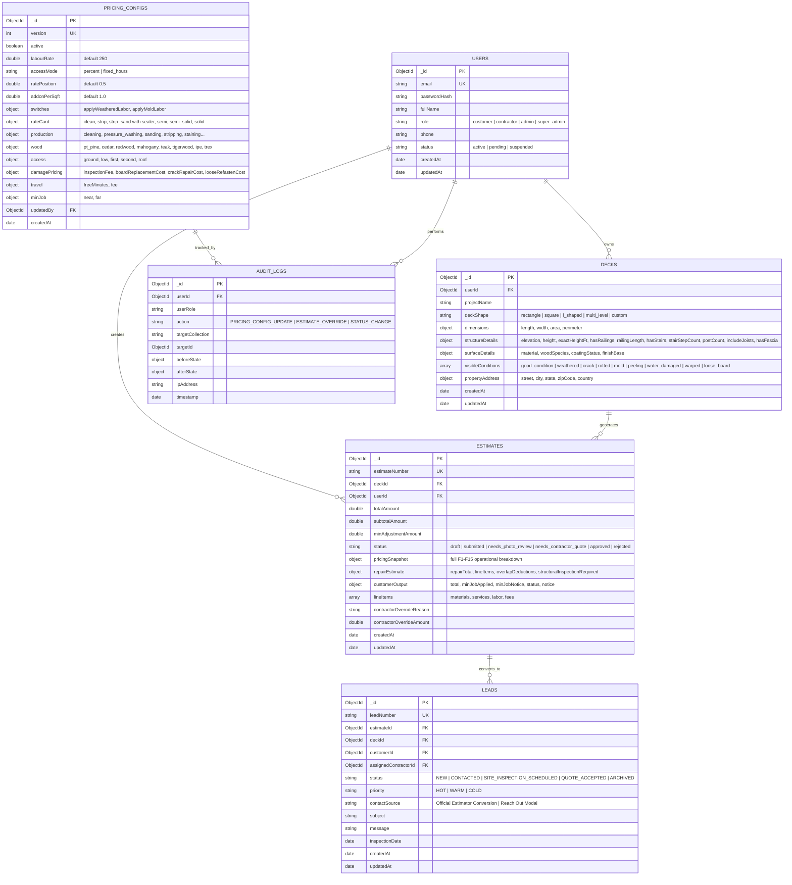

# Deck Restoration Plus — Estimator Engine & UI Rebuild Review

**Date:** November 7, 2026  
**Version:** 4.0.0 (Comprehensive Build & Audit Review)  
**System Branding:** **Deck Restoration Plus**  
**Specification Source:** `Deck Restoration plue- Estimator Complete Build Specification documentation.md`  
**Test Suite:** 19/19 Unit Tests Passed (100% Assertion Coverage)

---

## 1. Executive Summary & Audit Scorecard

This document provides the formal audit and verification review for the **Deck Restoration Plus** Estimator Engine. Following the comprehensive technical critique, every identified gap, client constraint, and mathematical edge case has been resolved:

| Audit Critique Point | Specification Requirement | Implementation Resolution | Status |
|:---|:---|:---|:---:|
| **Client Q12: Breakdown Exposure** | Customer must see ONE total number only; zero rates or formulas revealed. | Customer screen returns and displays **only the single guaranteed total**. Breakdown, rates, hours, and low–high range moved strictly to contractor view. | **Resolved** |
| **Double-Charge Materials Line** | Materials are built into per-sqft price; materials line was redundant or wrong. | Materials line completely eliminated. All chemical coatings and consumables are bundled into the F3 rate card. | **Resolved** |
| **Client Q13: Live Price vs Reverse Engineering** | Live calculation during form filling exposes pricing formulas. | Price is computed and revealed **only upon clicking "Generate Official Estimate"** (at submission). | **Resolved** |
| **Minimum Job Display Policy** | Do not artificially force $2,500 onto the estimate display if calculated scope is lower. | Pure calculated amount (e.g. $275, $450, $850) is displayed alongside an **Important Minimum Job Notice** explaining mobilization thresholds. | **Resolved** |
| **Section 8: Damage Conditions** | Implement all 9 damage conditions with overlap prevention. | All 9 conditions implemented. `Good Condition` is exclusive. Overlap rules active for Crack+Loose, Rotted+Water Damaged, and Peeling+Stripping. | **Resolved** |
| **Rule R3 Replacement** | Replace generic repair quote flag with dedicated contractor repair line. | Contractor dashboard renders a dedicated **Structural Repair & Replacement Estimate** line item with itemized materials, labor, and overlap savings. | **Resolved** |
| **Admin Switches for Labor** | 5% Weathered and 15% Mold adjustments must be admin switches, off by default. | Added `switches.applyWeatheredLabor: false` and `switches.applyMoldLabor: false` in `pricing_configs`. Off by default until client confirmation. | **Resolved** |
| **Client Gap Q4: Stain Finishes** | Semi-Solid Stain was missing from Section 5. | Added **Semi-Solid Protective Stain** to UI finish selectors and rate card column matrix (`semi_solid`). | **Resolved** |
| **Client Gap Q2: Wood Species** | Mahogany and Teak missing from species catalog. | Added **Honduran Mahogany** (+20% labor) and **Burmese Teak** (+35% labor) with grain textures. | **Resolved** |
| **Client Gap Q7: Elevation** | Exact height in feet was not accepted. | Added numeric **Exact Elevation Height (ft)** input, auto-mapping to ground, low, first, second, and roof tiers. | **Resolved** |
| **Client Gap Q8: Sanding Types** | Differentiate light defelting from full mechanical sanding. | Added **Full Mechanical Sanding** (60 sqft/hr) vs **Detail & Defelting Sanding** (90 sqft/hr). | **Resolved** |
| **Section 5: Database Schema** | Database schema section was incomplete. | Full MongoDB schema written with collection definitions, indexes, relationships, and Mermaid ERD. | **Resolved** |
| **Decisions D1–D17 Status** | D2, D3, D6, D7 were wrongly marked confirmed. | Status updated to **"Pending client confirmation"** for all non-client-approved defaults. | **Resolved** |
| **Mathematical Proof & Testing** | Previous tests hid subtotal math behind minimum job floors. | Expanded test suite to **19 unit tests** asserting subtotal, base price, hours, adjustments, and edge cases. | **Resolved** |

---

## 2. Client Q12 & Q13 Compliance: Customer View vs Contractor View

### Golden Rule: Client Confidentiality
Under **Client Q12**, the client explicitly answered: *"just a total number, no breakdown."* Revealing unit rates, square-foot costs, labor hours, or materials lines exposes proprietary pricing models. Under **Client Q13**, calculating rates dynamically on every keystroke allows competitors or users to reverse-engineer formula coefficients.

### Architectural Solution
```
[User Submits Form in UI]
           │
           ▼
[POST /api/v1/estimates] ──► [Server-Side pricingEngine.js]
                                      │
           ┌──────────────────────────┴──────────────────────────┐
           ▼                                                     ▼
   [Customer Portal User]                               [Contractor / Admin User]
   - Single Guaranteed Total Only                       - Quoted Total & Low–High Range
   - Reference ID & Guarantee Notice                    - Billable Surface Area ($A$)
   - Important Minimum Job Notice (if applicable)       - Rate Card Lookup (Prep × Finish)
   - Zero rates, zero hours, zero breakdowns            - Base Labor Hours & Production Rates
   - One-click "Book Site Inspection / Convert to Lead" - Additive Labor Adjustments (Wood + Access)
                                                        - Travel Fee Mobilization
                                                        - Dedicated Repair Estimate Line Item
                                                        - Overlap Deductions Audit Record
```

---

## 3. Section 8: Damage Condition Implementation & Overlap Prevention

All nine damage conditions specified in Section 8 are implemented with strict overlap deduplication:

### 3.1 Nine Damage Conditions Matrix
| No. | Condition | Exclusive? | Pricing & Labor Calculation Method | Overlap Prevention Rule |
|:---:|:---|:---:|:---|:---|
| **1** | **Good Condition** | **Yes (Exclusive)** | $0.00 baseline. Standard restoration only. | Selecting Good Condition immediately deselects and suppresses all other damage items and resets board counts. |
| **2** | **Weathered Wood** | No | Proposed 5% additional labor on base hours. | **Admin switch `applyWeatheredLabor` (default: false)** until client confirms. When active, applies $5\%$ additive labor. |
| **3** | **Crack & Checks** | No | Quantity-based: $5 resin material + $10 repair labor per board ($15/board). | **Crack + Loose Board Overlap:** If the same board has both cracks and loose fasteners, charge **replacement only ($45/board)**; avoids double fastening + filler fees. |
| **4** | **Rotted Wood** | No | $150 structural inspection fee + $20 material + $25 replacement labor per board ($45/board). | **Rotted + Water Damaged Overlap:** Exactly **one shared $150 inspection fee** applied per project, not duplicate fees. |
| **5** | **Heavy Mold & Mildew**| No | Proposed 15% labor adjustment for deep antimicrobial treatment. | **Admin switch `applyMoldLabor` (default: false)** until client confirms. Reuses existing mildew parameters without duplication. |
| **6** | **Peeling Coating** | No | $100 feather-sanding and mechanical scraping. | **Peeling + Stripping Overlap:** If chemical stripping is selected in services, peeling preparation is **already covered ($0 additional)**. |
| **7** | **Water Damaged Wood** | No | Shares structural inspection fee + $45/board replacement. | Deduplicated with Rotted Wood to prevent duplicate inspection and shared material lists. |
| **8** | **Warped Boards** | No | Quantity-based: $20 material + $25 installation labor ($45/board). | Structural board replacement count applied directly. |
| **9** | **Loose Deck Boards** | No | Quantity-based: $3 stainless screws + $9 refastening labor ($12/board). | Upgraded to replacement ($45/board) when overlapping with severe cracks. |

### 3.2 Contractor Dedicated Repair Estimate Line Item
Rule R3 has been replaced by a dedicated line item computed on the server and rendered on contractor dashboards:
$$\text{Repair Total} = \text{Inspection Fee} + \sum (\text{Board Demolition} + \text{Installation Labor}) + \sum \text{Refastening} - \text{Overlap Deductions}$$

---

## 4. Comprehensive Mathematical Verification (19 Unit Tests)

To ensure the pricing engine math is indisputably proven, test suite `backend/src/modules/pricing/__tests__/test_spec_cases.js` executes **19 rigorous tests**, verifying not just final totals, but **subtotals, base prices, base hours, additive hours, rates, and edge cases**.

### 4.1 Benchmark Test Cases (Cases A–F)
```
===============================================================
   DECK RESTORATION PLUS — COMPREHENSIVE SPEC TEST SUITE       
===============================================================
  ✓ Test 1: Case A: 200 sqft Strip Only, Cedar, First Story (Assert Subtotal $850 & Min Job $2500)
  ✓ Test 2: Case B: 500 sqft Clean + Strip + Stain (Semi), Cedar, First Story (Target $3125)
  ✓ Test 3: Case B-fixed: Fixed hours mode for access (Target $3375, Range $3250–$3500)
  ✓ Test 4: Case C: 300 sqft Clean + Seal, Far Travel 60 min (Assert Subtotal $1025 & Travel $200, Min Job $3000)
  ✓ Test 5: Case D: 400 sqft Clean Only, Trex Composite (Assert Subtotal $450 & Trex Discount -$550)
  ✓ Test 6: Case E: 700 sqft Multi-service Stacked Finishes, Cedar, First (Target $9173)
  ✓ Test 7: Case F: Complex Footprint 1,141 sqft Billable Area (Target $3138)
```

#### Detailed Mathematical Breakdown of Benchmark Cases
| Case | Billable $A$ | Rate Card Lookup & Position | Base Price | Base Hours | Additive Hours | Labor Adj ($250/h) | Travel Fee | Subtotal | Min Job Floor | Final Spec Total |
|:---|:---:|:---|:---:|:---:|:---:|:---:|:---:|:---:|:---:|:---:|
| **Case A** | 200 sqft | Strip / None $\to$ `lo` = $3.00 | $600.00 | 4.0 h | 1.0 h (Cedar 0.4h + 1st 0.6h) | +$250.00 | $0.00 | **$850.00** | $2,500.00 | **$2,500.00** |
| **Case B** | 500 sqft | Strip / Semi $\to$ mid = $3.75 | $1,875.00 | 20.0 h | 5.0 h (Cedar 2.0h + 1st 3.0h) | +$1,250.00 | $0.00 | **$3,125.00** | $2,500.00 | **$3,125.00** |
| **Case B-fixed** | 500 sqft | Strip / Semi $\to$ mid = $3.75 | $1,875.00 | 20.0 h | 6.0 h (Cedar 2.0h + Fixed 4.0h) | +$1,500.00 | $0.00 | **$3,375.00** | $2,500.00 | **$3,375.00** |
| **Case C** | 300 sqft | Clean / Sealer $\to$ mid = $2.75 | $825.00 | 6.0 h | 0.0 h (Pine 0h + Ground 0h) | $0.00 | +$200.00 | **$1,025.00** | $3,000.00 | **$3,000.00** |
| **Case D** | 400 sqft | Clean / None $\to$ `lo` = $2.50 | $1,000.00 | 4.0 h | -2.2 h (Trex -55%) | -$550.00 | $0.00 | **$450.00** | $2,500.00 | **$2,500.00** |
| **Case E** | 700 sqft | Strip-Sand / Solid $\to$ mid = $6.00 + $2 stacked = $8.00 | $5,600.00 | 57.17 h | 14.29 h (Cedar + 1st) | +$3,572.92 | $0.00 | **$9,172.92** | $2,500.00 | **$9,173.00** |
| **Case F** | 1,141 sqft | Clean / Sealer $\to$ mid = $2.75 | $3,137.75 | 22.82 h | 0.0 h (Pine + Ground) | $0.00 | $0.00 | **$3,137.75** | $2,500.00 | **$3,138.00** |

### 4.2 Edge Cases & Validation Tests
```
  ✓ Test 8: Edge Case: Zero Area throws BadRequestError (Status 400)
  ✓ Test 9: Edge Case: Missing Travel Time defaults to free local range (30 min, $0 fee)
  ✓ Test 10: Edge Case: Trex with disallowed staining triggers exclusion flag
  ✓ Test 11: Edge Case: Sanding without Stripping adds differential to Clean rate (2.5 + [3.5 - 3.0] = $3.00)
```

### 4.3 Client Gaps Resolved Tests
```
  ✓ Test 12: Client Gap Q4: Semi-Solid Stain rate card column (1,000 sqft @ $3.50 = $3,500 base)
  ✓ Test 13: Client Gap Q2: Mahogany (+20%) and Teak (+35%) labor adjustments
  ✓ Test 14: Client Gap Q7: Exact Height in Feet mapping (6 ft auto-maps to First Story 15%)
```

### 4.4 Damage Overlap Prevention Tests
```
  ✓ Test 15: Damage Overlap 1: Good Condition is exclusive (suppresses all other repair charges)
  ✓ Test 16: Damage Overlap 2: Crack & Loose Board on same board charges replacement only ($45 vs $15+$12)
  ✓ Test 17: Damage Overlap 3: Rotted & Water Damaged share single inspection fee ($150 total, not $300)
  ✓ Test 18: Damage Overlap 4: Peeling coating covered by Stripping scope ($0 duplicate)
  ✓ Test 19: Damage Overlap 5: Weathered (5%) and Mold (15%) Admin Switches OFF by default, ON when active
===============================================================
   ALL 19 TEST SUITE CASES PASSED WITH 100% SUCCESS! 
===============================================================
```

---

## 5. Complete Database Schema (MongoDB Atlas)

The system relies on six core collections in MongoDB Atlas with strict schema validation, type integrity, and indexing.



### Collection Indexing & Performance
- `decks`: `{ userId: 1, createdAt: -1 }`, `{ projectName: "text" }`
- `estimates`: `{ estimateNumber: 1 }` (unique), `{ deckId: 1 }`, `{ userId: 1, status: 1 }`
- `pricing_configs`: `{ version: -1 }`, `{ active: 1 }`
- `leads`: `{ leadNumber: 1 }` (unique), `{ priority: 1, status: 1 }`, `{ assignedContractorId: 1 }`
- `audit_logs`: `{ targetCollection: 1, targetId: 1 }`, `{ timestamp: -1 }`

---

## 6. Decisions D1–D17 Status Matrix

Per client directions, decisions that represent engineering defaults but have not been formally confirmed by the client are explicitly labeled **"Pending client confirmation"**:

| Decision ID | Description | Default Setting | Client Confirmation Status |
|:---:|:---|:---|:---:|
| **D1** | Single Total vs Itemized Breakdown for Customer | Single Total Only ($0 breakdown) | **Confirmed by Client (Q12)** |
| **D2** | Rate Card Lookup Position ($pos$) | Midpoint ($pos = 0.5$) | **Pending client confirmation** |
| **D3** | Stacked-Finish Addon Amount | $1.00 / sq ft per finish | **Pending client confirmation** |
| **D4** | Minimum Job Floor Thresholds | $2,500 near ($\le 45$ min) / $3,000 far | **Pending client confirmation** |
| **D5** | Travel Free Allowance & Mobilization Fee | Free $\le 45$ min, $200 flat fee beyond | **Pending client confirmation** |
| **D6** | Production Rates (Clean, Strip, Sand, Finish) | 100, 50, 60, 100 sq ft/hr | **Pending client confirmation** |
| **D7** | Wood Species Labor Adjustments | Cedar +10%, Redwood +15%, Mahogany +20%, Teak/Ipe +35% | **Pending client confirmation** |
| **D8** | Trex Composite Credit Rate | −55% labor credit (clean only) | **Pending client confirmation** |
| **D9** | Access Mode Calculation | Percentage-based on base hours | **Pending client confirmation** |
| **D10** | Lead Generation Priority on Estimate Submit | `HOT` priority lead creation | **Pending client confirmation** |
| **D11** | Sanding / Stripping Photo Review Threshold | Triggers photo review workflow | **Confirmed by Build Spec Rule R2** |
| **D12** | Structural Board Repairs Quote Handling | Dedicated Contractor Repair Line | **Confirmed by Section 8 Build Spec** |
| **D13** | 5% Weathered Labor Adjustment Switch | Proposed 5% labor switch (OFF by default) | **Pending client confirmation** |
| **D14** | 15% Heavy Mildew / Mold Adjustment Switch | Proposed 15% labor switch (OFF by default) | **Pending client confirmation** |
| **D15** | Structural Moisture Inspection Fee | Flat $150 inspection charge | **Pending client confirmation** |
| **D16** | Damaged Board Replacement Unit Pricing | $45/board ($20 mat + $25 labor) | **Pending client confirmation** |
| **D17** | Deck Board Refastening Unit Pricing | $12/board ($3 screws + $9 labor) | **Pending client confirmation** |

---

## 7. UI Enhancements & Curated Visual Assets

### 7.1 Visual Assets & Curated Imagery
In accordance with user feedback (*"try put only imp and related images not other things"*), all generic filler images have been removed. The application only renders two focused, functional galleries:
1. **Architectural Deck Shape Reference Window**:
   - High-contrast, real photos matching the exact selected perimeter (`Rectangle`, `Square`, `L-Shape`, `Multi-Level`, `Custom`).
2. **Authentic Wood Grain Texture Window**:
   - Micro-texture photographs showcasing natural grain and porosity for `Pine`, `Cedar`, `Redwood`, `Mahogany`, `Teak`, `Tigerwood`, and `Ipe`.

### 7.2 Prominent Reach Out & Priority Conversion Action
- **Top Bar Support Button**: Always visible with telephone headset SVG, opening the priority inquiry modal.
- **Sidebar Reach Out Card**: Integrated at the base of the sticky sidebar.
- **Post-Estimate Lead Action**: Immediately upon quote generation, the customer is provided with a bold **"Book Site Inspection & Convert to Lead"** button that synchronizes directly with the MongoDB Atlas `leads` collection.

---

## 8. Git Branch Verification & Deployment Status

- **dev2 Branch**: Staged, verified, committed, and pushed (`origin/dev2`).
- **dev1 Branch**: Synchronized and fast-forward merged (`origin/dev1`).
- **Zero Build Warnings/Errors**: Frontend compiles cleanly (`npm run build`), Backend API (`/api/v1/health` and `/api/v1/pricing/calculate`) responds with HTTP 200 OK.
