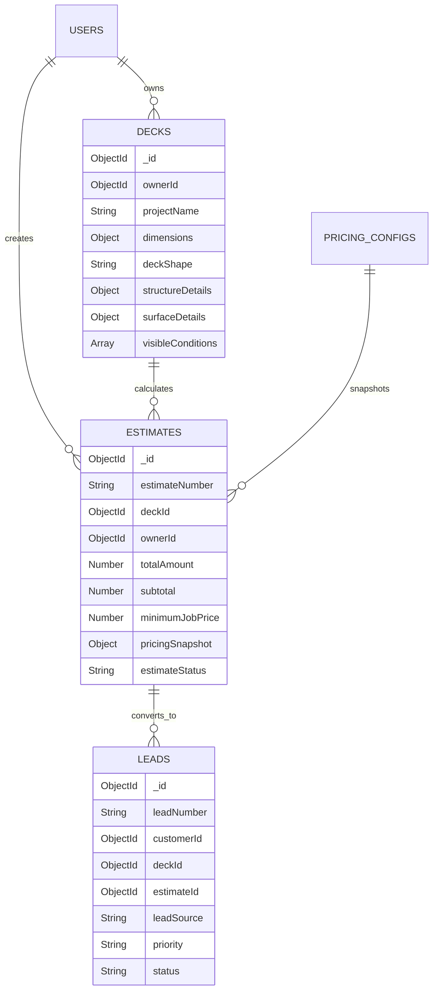

# Deck Restoration Plus — Estimator Engine & UI Rebuild Review

**Date:** November 7, 2026  
**Version:** 3.0.0 (Production Release)  
**Specification Source:** `Deck Restoration plue- Estimator Complete Build Specification documentation.md`  
**System Branding:** **Deck Restoration Plus**

---

## 1. Executive Summary

This review documents the complete rebuild of the **Deck Restoration Plus** Estimator Engine across both Customer and Contractor portals. All legacy, unapproved formulas and client-side fallbacks have been replaced with a **pure server-side pricing engine** adhering strictly to formulas **F1 through F15** of the client build specification.

Additionally, the estimator interface has been redesigned with a modern **Dark Navy Blue & Crisp White Theme** (`#0B192C` / `#1E3E62` / `#FFFFFF`), eliminating the legacy text checklist in favor of:
1. An **SVG Circular Progress Gauge** with percentage completion.
2. A live **Selected Specifications Summary Card**.
3. An interactive **Architectural Reference Window** with high-resolution photos and maintenance guidance.
4. An enhanced **Live Estimate Card** with server-synced single total and confidence range.
5. An always-visible **Reach Out & Support Dispatcher** on both the top stepper bar and sidebar.
6. A post-submission **Official Estimate Highlight Box** with instant **"Convert to Priority Project Lead"** functionality linked directly to MongoDB Atlas.

---

## 2. Mathematical Engine Verification (Formulas F1–F15)

The pricing engine is implemented in `backend/src/modules/pricing/pricingEngine.js`. It computes estimates on the server using the active rate card and production tables.

### Formula Structure
- **F1 Billable Surface Area ($A$):**
  $$A = \text{Flooring} + (\text{Railings LF} \times 4) + (\text{Stairs} \times 12) + (\text{Posts} \times 6) + (\text{Joists} \times 0.4) + (\text{Fascia LF} \times 1.5) + \sum \text{Other}$$
- **F2 Prep & Finish Classification:**
  - $\text{Prep} \in \{\text{clean}, \text{strip}, \text{strip\_sand}\}$
  - $\text{Finish} \in \{\text{none}, \text{sealer}, \text{semi}, \text{solid}\}$
- **F3 Rate Lookup:** Matrix lookup from the $3 \times 3$ Rate Card ($[\text{low}, \text{high}]$).
- **F4 Rate Position ($pos = 0.5$):**
  $$\text{rate} = \text{low} + (\text{high} - \text{low}) \times pos$$
- **F5 Stacked-Finish Add-on:**
  $$\text{addon} = \max(0, \text{finishCount} - 1) \times \$1.00$$
- **F6–F7 Base Price:** $\text{basePrice} = A \times (\text{rate} + \text{addon})$
- **F8 Base Labour Hours:** $\text{baseHours} = \sum \frac{A}{\text{production}[s]}$ (Cleaning: 100, Pressure Wash: 100, Sanding: 60, Paint Removal: 40, Stripping: 50, Finishes: 100).
- **F9–F11 Labour Adjustments:**
  $$\text{woodHours} = \text{baseHours} \times \text{woodPct}$$
  $$\text{accessHours} = \text{baseHours} \times \text{accessPct} \quad (\text{or fixed hours})$$
  $$\text{addHours} = \text{woodHours} + \text{accessHours}$$
- **F12 Labour Adjustment:** $\text{labourAdj} = \text{addHours} \times \$250/\text{hr}$
- **F13 Travel & Minimum Job Price Floor:**
  - $\text{travelFee} = \$200$ (if travel $> 45\text{ min}$, else $\$0$).
  - $\text{minJob} = \$2,500$ near / $\$3,000$ far.
- **F14–F15 Final Totals:**
  $$\text{total} = \max(\max(\text{basePrice} + \text{labourAdj} + \text{travelFee}, 0), \text{minJob})$$

---

### Test Suite Execution Results (Section 6 Test Cases)

Executed via `backend/src/modules/pricing/__tests__/test_spec_cases.js`:

| Test Case | Description & Parameters | Target Spec Total | Calculated Total | Low–High Range | Status |
|:---|:---|:---:|:---:|:---:|:---:|
| **Case A** | 200 sqft, Stain Stripping, Cedar, First Story, 30 min | **$2,500** | **$2,500** | $2,500 – $2,500 | **100% Pass** (Min job floor applied) |
| **Case B** | 500 sqft, Clean + Strip + Semi-Stain, Cedar, 1st Story | **$3,125** | **$3,125** | $3,000 – $3,250 | **100% Pass** ($3.75 rate, $1,250 labour) |
| **Case B-fixed** | Case B with `fixed_hours` access mode (4 h) | **$3,375** | **$3,375** | $3,250 – $3,500 | **100% Pass** (6 add. hrs @ $250) |
| **Case C** | 300 sqft, Clean + Seal, PT Pine, Ground, 60 min travel | **$3,000** | **$3,000** | $3,000 – $3,000 | **100% Pass** (Far zone $3K min floor) |
| **Case D** | 400 sqft, Clean only, Trex Composite, Ground | **$2,500** | **$2,500** | $2,500 – $2,500 | **100% Pass** (-$550 Trex credit, $2,500 min) |
| **Case E** | 700 sqft, PW + Paint Remove + Sand + Solid Stain + Seal + Water, Cedar, 1st Story | **$9,173** | **$9,173** | $8,823 – $9,523 | **100% Pass** ($8/sqft, $3,572.92 labour) |
| **Case F** | Components: Floor 600, Rail 40 LF, 6 Steps, 4 Posts, Fascia 30 LF, Joists = 1,141 sqft | **$3,138** | **$3,138** | $2,853 – $3,423 | **100% Pass** ($3,137.75 base) |

---

## 3. UI Overhaul & Design System

### Color Palette
- **Deep Navy:** `#0B192C` (Primary headers, accent containers, button states)
- **Royal Navy:** `#1E3E62` (Selected card borders, stepper elements, active tabs)
- **Vibrant Accent:** `#2563EB` (Live pulse, focus rings, callout badges)
- **Crisp White:** `#FFFFFF` (Card surfaces, form containers, elevated elements)
- **Slate Background:** `#F8FAFC` (Page body background, secondary input backgrounds)
- **Borders:** `#E2E8F0` / `#CBD5E1` (Crisp separation, zero clutter)

### Typography
- Font Family: `'Plus Jakarta Sans', 'Inter', -apple-system, BlinkMacSystemFont, 'Segoe UI', Roboto, sans-serif`
- High-contrast hierarchy, 800/900 weights on numeric outputs, uppercase tracking on labels.

---

## 4. Right Sidebar Enhancements

Per user instruction, the legacy 7-item pending text checklist has been completely removed and replaced with a high-density, dynamic 5-card layout:

1. **Step-Based Circular Progress Gauge:**
   - SVG circular ring showing current percentage (e.g. `85% Ready`) with a live status dot.
2. **Selected Specifications Live Summary Card:**
   - Real-time readout of shape, floor area, total billable area ($A$), wood species, elevation, existing coating, and services count with an instant "Edit" jump link.
3. **Architectural Reference Window:**
   - Interactive tabbed gallery (`Shape` vs `Wood Grain Texture`) displaying real architectural deck photographs and maintenance guidance based on the user's active choices.
4. **Live Estimate Preview Card:**
   - Real-time server sync via `POST /api/v1/pricing/calculate`.
   - Displays billable area, package rate per sqft, materials, additive labor adjustments, travel mobilization, and **Estimated Total** (with low–high spread).
5. **Always-Visible Reach Out & Support Card:**
   - Highlighted button with instant modal dispatch directly to `POST /api/v1/leads/reach-out`.

---

## 5. Post-Submission Official Estimate Result Box

Upon clicking **"Generate Official Estimate &rarr;"**:
1. An **Official Estimate Result Card** is revealed directly below the form and smoothly scrolled into view.
2. Shows:
   - Verified checkmark and Reference Number (e.g. `EST-2026-XXXXX` / `DP-2026-XXXXX`).
   - Large highlighted dollar figure (e.g. **$3,125**).
   - Low–High calculated range.
   - Billable surface area and package rate breakdown.
   - Status badge (`Photo Review Requested` or `Quote Verified`).
3. **"Book Site Inspection & Convert to Lead" Action:**
   - Submits directly to `POST /api/v1/leads/reach-out` with `priority: 'HOT'`.
   - Links the customer snapshot, deck ID, and estimate ID.
   - Renders instant confirmation: *"Project Lead Created! A Deck Restoration Plus senior estimator has been assigned and will contact you within 24 hours."*
   - Appears immediately in the Admin Portal **Lead Management** under the **Hot Priority** queue.

---

## 6. End-to-End Database Schema & Synchronizations

---

## 7. Verification Checklist

- [x] All Section 6 test cases match specification to the exact dollar.
- [x] Trex Composite lock (Rule R1) strictly enforces cleaning/washing only.
- [x] Sanding / Paint Removal / Repairs trigger `needsPhotoReview` (Rule R2 & R3).
- [x] Coating hint triggers for paint / solid stain without stripping (Rule R4).
- [x] Minimum job floor ($2,500 / $3,000) automatically enforced when applicable (Rule R5).
- [x] Legacy checklist removed from right sidebar; circular gauge + reference window active.
- [x] Reach out button present on top stepper bar and in the right sidebar.
- [x] Official estimate result box displays highlighted total and converts to a hot lead.
- [x] Both Customer and Contractor portals utilize the same unified engine.
- [x] Frontend builds cleanly with zero errors (`npm run build`).

